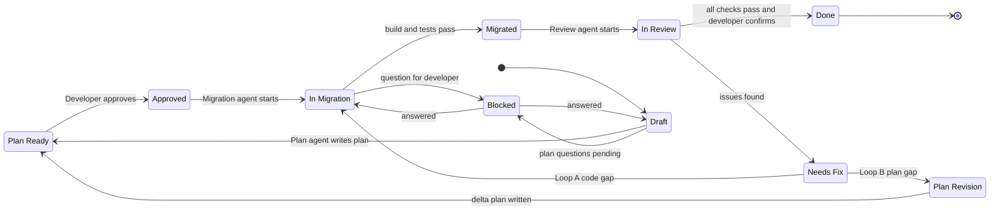
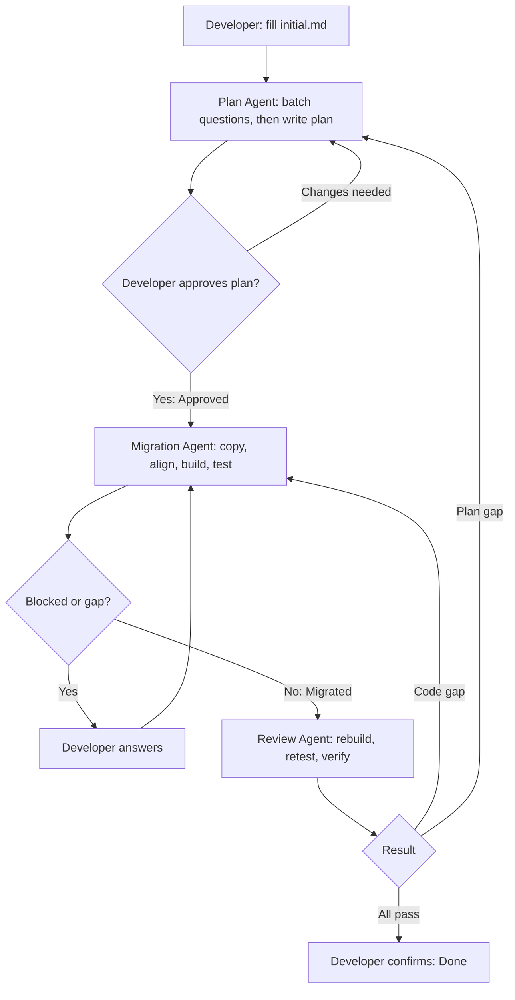
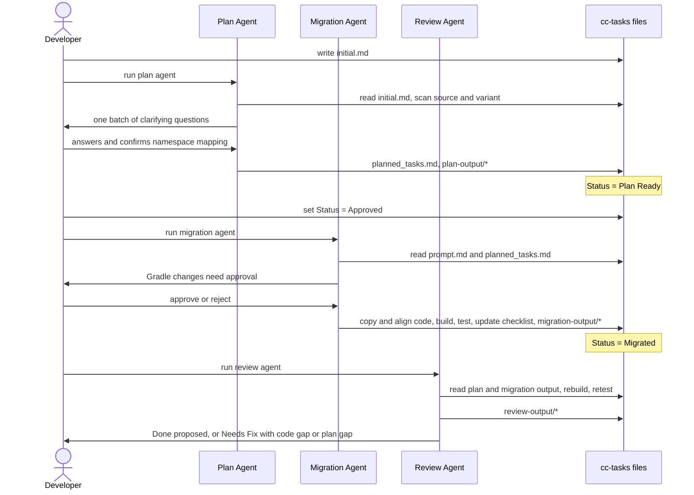

# Android Feature Migration Agents (Plan, Migration, Review)

A three-agent workflow for GitHub Copilot in Android Studio. It moves **one feature at a time** from a **source project** into a **variant source set** of a destination app using **lift and shift**. You approve at the key gates, and progress is tracked in checklists.

**Author:** Rajendhiran Easu

**About this document.** This README is the project reference. It holds the rules, the agent outlines, the file templates, the setup and a worked example in one place. The agents themselves read only `cc-tasks/_shared/rules.md` and their own agent file. Section `5.N` below mirrors section `N` of `rules.md`, section 6 mirrors the three agent files, and Appendix A mirrors `templates.md`. When behavior needs tuning, change `rules.md` or the agent file first, then update this document (see Appendix B).

**Status:** complete and ready for a pilot run. It has not been tested in Android Studio yet (see section 15).

---

## 1. Golden rules

1. **Source is read-only.** Never write, modify, delete or format anything in the source project.
2. **The only writable area is the destination variant** (`src/<flavor>/java`, `src/<flavor>/res`, `src/<flavor>/AndroidManifest.xml`, variant test source sets).
3. **Destination `main` is never scanned, reused or edited.** The variant is self-contained. If a migrated file needs something (including `BaseActivity`, `BaseFragment`, base custom views, base WebView classes), copy it from the **source** into the variant.
4. **Lift and shift.** Copy code as is. Whole files are copied with `cp`; merged members are copied exactly, with no tidying. Take only the members the feature needs, not whole files full of unrelated things. A big base class brings only the methods the feature uses, plus what they depend on. If the file already exists in the variant, add only the feature's members and never remove or change existing ones.
5. **Package and file names stay as is.** The same sub-package folders are recreated in the variant. Nested, inner, companion and sealed classes stay inside their parent.
6. **Layouts come with their classes**, including all qualified variants (`layout-land` and so on) and the layouts they include. Binding classes are generated and never copied.
7. **Alignment changes only.** The only edits to copied code are `R`, binding, `BR` and `BuildConfig` references, class names in XML and manifest, and import cleanup. Anything else is a forced change and goes in its own section of the output.
8. **Outside references are classified** as copy, host-provided or implicit. Host-provided ones (session or user data, DI component creation, SDK init) and implicit ones (base-class setup the feature relies on) go to you, because the code alone cannot say how the destination app supplies them.
9. **Dagger is not a special case.** Same lift and shift. Missing pieces are copied from the source.
10. **Ask, do not assume.** Gradle edits, forced renames, duplicate classes or bindings, database items and anything copy-plus-alignment cannot fix are developer decisions.
11. **Unit tests move with their classes.** Never delete or disable a test to get a green build.
12. **Your hints are starting points.** Only "Must exclude" and "Out of scope" are hard limits.
13. **Wiring into `main` is the developer's job.** The agents hand over an entry contract.
14. **Do not break other flows.** Only variant files change (plus approved Gradle edits). The build is the validator.
15. **You set `Approved` and `Done`.** Agents only propose.

---

## 2. Package contents, folder layout and setup

### 2.1 What is in the package and where it goes

```
migration-agents/
  README.md                          <- this guide (keep it anywhere, not needed in the repo)
  HANDOFF.md                         <- optional notes for continuing the design discussion in a new chat
  .github/
    copilot-instructions.md          <- short always-on rules + your default paths
    agents/
      plan.agent.md
      migration.agent.md
      review.agent.md
    prompts/
      new-task.prompt.md             <- /new-task
      resume.prompt.md               <- /resume
  cc-tasks/
    _shared/
      rules.md                       <- the single source of truth for all agents
      templates.md                   <- formats for every output file
```

Copy **`.github/`** and **`cc-tasks/`** into the **destination repo root** (the folder with `app/`, `settings.gradle` and `.git`, which is the project open in Android Studio). If you already have a `.github/copilot-instructions.md`, append ours to it instead of overwriting.

### 2.2 Where everything lives after setup

```
/path/to/source-pinned/                  <- OUTSIDE the destination. Read-only. Pinned checkout
  app/ ...

/path/to/destination-repo/               <- open this in Android Studio
  .github/                               <- copied from this package
  cc-tasks/
    _shared/                             <- copied from this package
    <task-name>/                         <- created per feature
      initial.md                         <- you, via /new-task
      planned_tasks.md                   <- plan agent; migration agent ticks it
      plan-output/        summary.md  findings.md  prompt.md
      migration-output/   summary.md  file-map.md  gaps.md
      review-output/      checklist.md  findings.md
  app/
    build.gradle                         <- shared; edited only with your approval
    src/
      main/                              <- another product's code. NEVER touched
      <flavor>/                          <- your variant: the ONLY writable code area
        java/   res/   AndroidManifest.xml
      test<Flavor>/                      <- variant unit tests
```

| Agent | Writes | Never writes |
|---|---|---|
| `@plan` | `cc-tasks/<task-name>/` plan files | any code |
| `@migration` | `app/src/<flavor>/...`, approved Gradle edits, its own output files | the source project, `app/src/main` |
| `@review` | `review-output/` and `planned_tasks.md` corrections | any code |

### 2.3 One-time setup

1. **Copy the files** (section 2.1) into the destination repo root.
2. **Show hidden folders:** in Android Studio switch the Project tool window from Android view to **Project** view.
3. **Fill in the defaults** in `.github/copilot-instructions.md`: the three `<FILL_IN>` values (default source path, destination path, variant).
4. **Prepare the source.** Make a clean checkout of the source project at the tag or commit you want, in a folder outside the destination repo, and make it read-only:

   ```bash
   git -C /path/to/source-project worktree add /path/to/source-pinned <tag-or-commit>
   chmod -R a-w /path/to/source-pinned        # macOS / Linux (Windows: read-only in folder properties)
   ```

   Use `/path/to/source-pinned` as the source path in your tasks.
5. **Create the destination branch** from a clean working tree (`git status`):

   ```bash
   git checkout -b migration/<task-name>
   ```

   Its starting commit is the baseline the review agent compares against.
6. **Keep the tooling out of your PR.** Add to `.git/info/exclude` (local only, recommended):

   ```text
   .github/agents/
   .github/prompts/
   cc-tasks/
   ```

   (Or commit them on the migration branch only and remove before the PR.) The agents' boundary checks ignore `.github/` and `cc-tasks/`.
7. **Run the preflight tests** in Copilot chat:
   - *Read test:* "Open `/path/to/source-pinned/app/build.gradle` and show the first 20 lines." Must work. If it cannot read outside the project, put the source inside the workspace instead (a snapshot folder, or an attached content root).
   - *Terminal test:* "Run `ls` on `/path/to/source-pinned/app/src`." If there is no terminal, you run Gradle and copy images and fonts yourself, and the agents tell you exactly what to run.
   - *Agent test:* type `@plan` and `/new-task`. They must appear. If your plugin version does not support custom agents or prompt files, the same content can be used as plain prompt files.
8. **Check the flavor:** your variant name must exist in `productFlavors` in `app/build.gradle`.

### 2.4 Which command next

| Status | You do |
|---|---|
| (no task yet) | `/new-task` |
| Draft | `@plan cc-tasks/<task-name>` and answer its single batch of questions |
| Plan Ready | Review the plan files, then set `Status: Approved` yourself |
| Approved | `@migration cc-tasks/<task-name>` |
| Blocked | Answer the question the agent asked, then re-run the same agent |
| Migrated | `@review cc-tasks/<task-name>` |
| Needs Fix | Code gap: `@migration`. Plan gap: `@plan`. The review says which |
| Done proposed | Read `review-output/checklist.md`, then set `Status: Done` yourself |
| Not sure | `/resume` with the task name. It says the next command |

### 2.5 What the agents create per task

```
cc-tasks/<task-name>/
  initial.md                   <- you (via /new-task or by hand), inside cc-tasks, not in the project root
  planned_tasks.md             <- status header + checklist per iteration
  plan-output/      summary.md  findings.md  prompt.md
  migration-output/ summary.md  file-map.md  gaps.md
  review-output/    checklist.md  findings.md
```

Use `planned_tasks.md` everywhere. Do not mix `tasks.md` and `planned tasks.md`. The folder is `cc-tasks` (with a hyphen). Use a short feature name for `<task-name>`, for example `help-center`.

---

## 3. Diagrams

### 3.1 Status lifecycle



`Blocked` always records `blocked_from: <status>` so the agent resumes in the right place.

### 3.2 End-to-end flow



### 3.3 Who talks to whom (one iteration)



---

---

## 4. Inputs: `initial.md`

Only inputs live here. Behavior rules do not belong in the task file.

**Core principle: a field you fill in is a starting point, not a limit. The agent begins there but still follows the discovery traversal to find the whole feature. Only "Must exclude" and "Out of scope" are hard limits.**

Create it with `/new-task`, or by hand at `cc-tasks/<task-name>/initial.md`:

```markdown
# Task: <task-name>

Status: Draft
Destination branch: migration/<task-name>
Source reference: <branch / tag / commit>   (blank = current checkout)

## 1. Source project directory path
<path>   (blank = default)
Source modules involved: <app, :lib-x, ...>   (blank = agent finds them)

## 2. Destination project path and variant
<path> / variant: <flavor>   (blank = default)
Build commands: assemble<Flavor>Debug, test<Flavor>DebugUnitTest   (blank = defaults)

## 3. Feature or functionality
<what the feature is, screens involved>
Entry point (if known): <class>
Launched in source via: <Intent / Fragment attach / route>   (optional)

## 4. Specific things
<quirks, special notes>
Must include: <classes, layouts, resources the agent might miss>
Must exclude: <anything that must not move>
Locales: all   (or list)
Gradle pre-approval: no   (or: flavor-scoped dependency additions at source versions)
Known host-provided things: <session/user data, DI component or inject call, base-class setup, init calls you know about>   (optional)

## Out of scope
<other features living in the same files>

## References (optional)
<ticket, design, notes>
```

Fill the default paths once in `.github/copilot-instructions.md` so the agents can resolve blanks.

### How each field is used

| Field you fill in | How the agent treats it |
|---|---|
| **Entry point** | Seed for the traversal. The agent starts here but also follows the feature wherever it leads (other screens, deep links, other launch paths the feature uses) |
| **Launched in source via** | Documented first in the entry contract. Other launch paths the agent finds are listed alongside it |
| **Source modules involved** | Starting set to search. The agent follows references into other modules when the feature needs them and notes which ones |
| **Must include** | Always brought, in addition to whatever discovery finds |
| **Must exclude / Out of scope** | **Hard limit.** Never brought, even if the traversal reaches them. The agent notes what it skipped and why |
| **Locales** | A preference that is followed as given (all by default) |
| **Gradle pre-approval, Build commands, Source reference** | Settings, followed as given. Pre-approval covers only what is listed |
| **Known host-provided things** | Session or user data, DI component or inject call, base-class setup, init calls you already know about. The agent still asks about any it finds that you did not list |

Blank fields: the agent resolves them from defaults or discovery. Everything resolved or discovered beyond your hints is written into `plan-output/findings.md`, so you can review it at plan approval.

---

## 5. Shared rules (`cc-tasks/_shared/rules.md`)

This section mirrors `rules.md`. `5.N` is section `N` of that file, so when an agent file says "rules section 6", read 5.6 here. Placeholders in angle brackets (`<flavor>`, `<source.ns>`, `<dest.ns>`, `<variant.pkg>`) are always resolved from the Gradle files and the project, never typed from memory.

### 5.1 Access boundaries

| Area | Access |
|---|---|
| Source project (all of it) | Read-only. The only place code and resources are taken from |
| Destination variant source sets (`src/<flavor>/java`, `src/<flavor>/res`, `src/<flavor>/AndroidManifest.xml`, variant test source sets) | Read and write |
| Destination `main` | Never scanned, reused or edited |
| `app/build.gradle` and other Gradle files | Only with developer approval, flavor-scoped where possible |
| `cc-tasks/<task-name>/` | Written by the agent whose role owns that output (see the agent files) |

Boundary and scope checks (what changed outside the variant) ignore `.github/` and `cc-tasks/`, which are tooling.

The variant is self-contained. If a migrated file needs something (including `BaseActivity`, `BaseFragment`, base custom views, base WebView classes), copy the needed members from the **source** into the variant. Never check whether `main` has an equivalent.

Wiring the feature into `main` (Fragment attach, Intent, Activity launch, `BuildConfig` condition) is the developer's job. The agents produce an entry contract (section 12).

### 5.2 Preflight (before any work)

Each agent runs these checks and reports the result in its first message. If a check fails, stop and tell the developer what to fix.

1. **Source path readable:** open one file from the source path in `initial.md` (for example its `app/build.gradle`). If the file cannot be read, stop. Do not guess its contents.
2. **Source reference:** if `initial.md` gives a branch, tag or commit, verify the source checkout is at that reference (`git -C <source> rev-parse HEAD`) when a terminal is available. If there is no terminal, ask the developer to confirm.
3. **Terminal available?** Note whether the agent can run commands. If not: Gradle builds, `cp` of binary resources and `git diff` become developer steps (see sections 5 and 10).
4. **Destination baseline:** the destination is on the branch named in `initial.md` with a baseline commit. Verify with git if possible, otherwise ask the developer to confirm. Review diffs against this baseline.
5. **Destination namespace and flavor:** read `namespace` from the destination `app/build.gradle` and confirm `<flavor>` exists in `productFlavors`.

### 5.3 Reading `initial.md`: hints and limits

- A value the developer fills in (entry point, launch path, source modules, must include) is a **starting point**, not a limit. Begin there, but still discover the whole feature with the traversal in section 4.
- **Hard limits** are only "Must exclude" and "Out of scope". Never bring those, even if the traversal reaches them. Log what was skipped and why.
- Settings are followed as given: Locales, Build commands, Source reference, Gradle pre-approval (covers only what is listed).
- A blank field is resolved from the defaults in `.github/copilot-instructions.md` or by discovery. Write every resolved or discovered value into `plan-output/findings.md`.
- Anything found beyond the developer's hints goes in a "Discovered beyond hints" section of `findings.md` (what, where, why the feature needs it) for review at plan approval.

### 5.4 Discovery procedure

The Plan agent builds the file list with this traversal, not by guessing.

1. Start at the entry point (Activity, Fragment, composable, route). If none is given, find it from the feature description.
2. Walk outward, adding each reference to a **visited list**:
   - ViewModels, repositories, use cases, managers
   - data sources, API interfaces, models, enums, constants
   - adapters, view holders, listeners, callbacks, items, content objects
   - custom views and the base classes the feature extends
   - Dagger pieces the feature uses (section 8)
   - analytics events and trackers
   - layouts and everything they reference (drawables, colors, dimens, strings, styles, fonts, anim)
   - manifest declarations and navigation entries
   - unit tests for every class on the list
3. From shared or multi-feature files, take only the members the feature needs (methods, constants, properties, nested classes, generics).
4. Stop when no unvisited references remain. Skip anything in "Must exclude" or "Out of scope".
5. Save the visited list in `plan-output/findings.md`.

Layout rule: for every Activity, Fragment, adapter, ViewHolder, custom view and composable-hosting view on the list, find the layout it uses (R.layout.x, setContentView, inflate, or the binding class name mapped back to its layout file, for example ItemFooBinding to item_foo.xml). Copy that layout and all its qualified variants (layout-land, layout-sw600dp and so on), plus every layout it includes. Never copy generated binding classes; they are generated from the layout. Copy only the resource entries the layouts use.

Dependency rule: for every reference the feature makes outside its own classes (members of base classes, session, user or app-state objects, injected types, singletons, Application or Context level services), classify it:
1. **Copy:** the code can be copied from the source into the variant (the normal case). Bring only the members used.
2. **Host-provided:** the value or state is created or filled at runtime by the app (for example session or login data, a Dagger component, SDK init). Copying the class gives the variant its own empty instance, not the app's. Do not assume. Record it under "Dependencies and host expectations" in `plan-output/findings.md` and ask how it should reach the feature (Intent extras, Fragment arguments, a call the host makes, or another way).
3. **Implicit:** behavior the feature relies on but never calls directly (for example base-class `onCreate` setup, toolbar or analytics init, lifecycle observers). List base-class overrides that were not reached and ask whether the feature depends on them.

### 5.5 What a feature can include (checklist for plan and review)

- **Code:** Activities, Fragments, custom views, WebView and base classes, ViewModels, repositories, managers, models, nested classes, generics, adapters, view holders, listeners, analytics, utils, constants, Kotlin and Java
- **UI:** Compose and XML layouts, menus, navigation graphs, data binding variables and imports
- **Resources:** colors, dimens, strings (default and every `values-xx` in scope), styles, themes, fonts, drawables (all densities, night variants), images, anim, raw, xml
- **Manifest:** activities, services, receivers, providers, permissions, intent filters, meta-data
- **Dagger:** components, subcomponents, modules, provides, binds, scopes, qualifiers, inject targets
- **Tests:** unit tests, test resources, fakes, test utilities
- **Gradle (approval-gated):** dependencies, plugins, `buildFeatures`, `BuildConfig` fields, Proguard/R8 rules
- **Other:** feature flags and remote config keys, network layer pieces. Database entities, DAOs and migrations are always asked about first (section 11)

Binary resources (PNG, WebP, fonts, audio) cannot be reliably written as text. Copy them with a terminal `cp`. If no terminal is available, list them in `migration-output/gaps.md` for the developer to copy, and the Review agent verifies they arrived.

### 5.6 Merge rules (file already exists in the variant)

| Situation | Action |
|---|---|
| File does not exist | Create it (and its package) with only the needed members |
| File exists | Add only the feature's methods, constants, properties, params. Never edit or remove existing members |
| Existing override in a variant base class | Keep it. Add only what the feature needs |
| Feature needs behavior that conflicts with an existing variant member | Stop and ask |
| Same resource name already in the variant | Existing file: add only missing entries. Same name with a different value: stop and ask |
| Same layout name with different content | Stop and ask (view IDs and binding fields would change) |

Copy method: for a file brought **whole, with all its members** (action `create`), copy it with a terminal command (`cp`) and then apply only alignment edits. Do not retype it. For merged members, copy their text exactly as it appears in the source. Do not reformat, rename, reorder or tidy anything. If no terminal is available, copy the text exactly as read and say so in `migration-output/summary.md`; the review agent will diff it.

Copy code as is. The only edits to copied code are alignment edits (section 7). Anything else is a forced change (section 13).

### 5.7 Namespace and import alignment

Destination `R`, binding, `BR` and `BuildConfig` come from the `namespace` in the destination `app/build.gradle`, not from the variant folder or package. The source may use several `R` packages (app and library modules).

1. Read the source namespace(s) and the destination `namespace`. Never guess.
2. Write a mapping table in `plan-output/findings.md`; the developer confirms it at plan approval.

| Item | Source package | Destination package |
|---|---|---|
| `R` | `<source.ns>.R` (and library `R`s) | `<dest.ns>.R` |
| Binding classes | `<source.ns>.databinding.*` | `<dest.ns>.databinding.*` |
| `BR` | `<source.ns>.BR` | `<dest.ns>.BR` |
| `BuildConfig` | `<source.ns>.BuildConfig` | `<dest.ns>.BuildConfig` |
| Feature classes | `<source.pkg>` | Same `<source.pkg>`, unchanged (only a forced change, listed in section 13, may alter it) |

Package and file names are kept **as is**. Recreate the same sub-package folders in the variant (for example `.../help/ui/adapter/ArticleAdapter.kt` goes to `src/<flavor>/java/.../help/ui/adapter/ArticleAdapter.kt`), create only the packages that contain migrated files, and reuse a package if it already exists in the variant. The `package` line must match the folder. Nested, inner, companion and sealed classes stay inside their parent class. Only `R`, binding, `BR` and `BuildConfig` follow the destination namespace.

3. Apply the mapping to Kotlin, Java, tests, layout XML, manifest and nav graphs:
   - imports, including `import static`; replace wildcards with explicit imports
   - `<import type>` and `<variable type>` in data binding layouts
   - custom view tags and `android:name` for fragments and activities
   - manifest class names
   - inline fully qualified references (`com.source.R.id.x`) and reflection strings: flag them, do not silently edit
4. A file whose package equals the destination `namespace` needs no `R` import. Compare each file's new package before adding or removing imports.
5. With non-transitive R classes, library resources need the owning module's `R`. Resources that exist only in a source library module are copied into the variant `res`.
6. Optimize imports and remove wrong ones at the end.
7. After alignment, search the migrated files for references to generated classes qualified with the source namespace (`<source.ns>.R`, `<source.ns>.databinding.`, `<source.ns>.BR`, `<source.ns>.BuildConfig`, and any source library `R` package) in `.kt`, `.java`, `.xml` and the manifest. None may remain. Package names of copied classes are kept as is, so a plain search for the namespace string can also match legitimate packages (for example when the package root equals the namespace); judge each hit.

### 5.8 Dagger

Dagger is not a special case. It follows the same lift-and-shift rules.

- Find the feature's Dagger pieces in the source (components, subcomponents, modules, provides, binds, scopes, qualifiers, inject classes, factories, constants used by them) and copy them as is.
- Take only the members the feature needs. If the file exists in the variant, add only those members and leave everything else alone.
- Align `R`, binding and `BuildConfig` imports only. Package and file names stay as is.
- Build. If Dagger reports a missing binding, copy that provider from the source and log it.
- Read only the **first** Dagger error; later ones are usually cascades.
- If something cannot be fixed by copying or aligning (for example a duplicate binding), log it in `gaps.md` and ask.
- Missing `dagger`, `kapt` or `ksp` setup is a Gradle change and needs approval.

### 5.9 Gradle policy

- Compare source and destination `app/build.gradle`: dependencies, plugins, `buildFeatures` (view binding, data binding, compose), `BuildConfig` fields, `kapt`/`ksp`, Proguard.
- Always ask before editing. Show exactly what will be added and why. Pre-approval in `initial.md` covers only what is listed there.
- Prefer flavor-scoped configurations (`<flavor>Implementation`, `test<Flavor>Implementation`).
- Use the version the source uses. If the destination already has the library at a different version, do not bump it. Stop and ask.

### 5.10 Build and test gates

| Who | When | What |
|---|---|---|
| Migration agent | Before setting `Migrated` | `assemble<Flavor>Debug` and `test<Flavor>DebugUnitTest` (or the commands given in `initial.md`). Fix mechanical errors and log them. Everything else goes to `gaps.md` |
| Review agent | Independently | Rebuild, rerun tests, run lint if available |

- **Mechanical (agent fixes and logs):** wrong namespace, missing import, unresolved `R` or binding, a missing class or resource that exists in the source.
- **Everything else goes to the developer:** duplicate class or binding, behavior differences, test failures caused by real differences, anything needing a `main` change.
- Never delete, skip or disable a test to get a green build.
- If no terminal is available, write the exact commands into the checklist. The developer runs them and pastes the output back. Work continues from there.

### 5.11 Must-ask list

1. Any Gradle or dependency change (unless pre-approved in `initial.md`)
2. Any forced rename (class, file, resource) beyond alignment
3. Duplicate class or duplicate binding errors
4. Same layout or resource name in the variant with different content
5. Database entities, DAOs, migrations
6. Anything that would require changing `main`
7. Version conflicts
8. Anything the traversal reaches that looks like a different feature rather than part of this one (ask before including it)
9. Any assumption about behavior that cannot be confirmed from code
10. Runtime state or setup the feature depends on that is created elsewhere (session or user data, DI component creation or the inject call, Application-level init, base-class lifecycle setup)

Ask all clarifying questions in one batch, not one at a time. Never assume.

### 5.12 Entry contract

Written by the Migration agent in `migration-output/summary.md`, verified by the Review agent:

- Entry class, fully qualified name in the variant
- How it is launched: Intent action or component, required extras, Fragment arguments, `newInstance` signature (list every launch path found, the one in `initial.md` first)
- Manifest entries added in the variant
- What the feature expects from the host: container view ID, theme, init calls, callbacks to implement, Application-level requirements, session or user data it reads and how it must be supplied, DI component creation or the inject call, base-class setup it relies on
- Note for the developer: a string-based Intent contract is the safest way to wire from `main` when other flavors do not contain the class. A direct class reference needs matching stubs in those flavors.

### 5.13 Forced changes

Every output file set ends with a **Forced changes** section for anything beyond plain alignment: renames, signature changes, added parameters, stubbed members. Each entry lists file, change and reason. If there are none, write "None".

### 5.14 Status lifecycle and iterations

Statuses: `Draft`, `Plan Ready`, `Approved`, `In Migration`, `Blocked`, `Migrated`, `In Review`, `Needs Fix`, `Plan Revision`, `Done`.

| Transition | Set by |
|---|---|
| Draft to Plan Ready | Plan agent |
| Plan Ready to Approved | Developer only |
| Approved to In Migration, In Migration to Migrated | Migration agent |
| Migrated to In Review, In Review to Needs Fix | Review agent |
| Needs Fix to Plan Revision, Plan Revision to Plan Ready | Plan agent |
| Any to Blocked | Any agent (record `Blocked from: <status>`; resume there when answered) |
| In Review to Done | Review agent proposes, developer sets |

Header at the top of `planned_tasks.md`, updated by every agent:

```
Status: <status>
Iteration: <n>
Blocked from: <status or ->
Last updated by: <agent>
Open issues: <n> (<x> code gap, <y> plan gap)
```

Rules:
1. Never rewrite history. Add `Iteration N` sections to `planned_tasks.md`. Completed items stay checked unless review proves them wrong, then uncheck with a note.
2. **Loop A (code gap):** the plan was right, execution missed it. No new approval. Migration redoes only the failed items.
3. **Loop B (plan gap):** the plan missed something. Plan agent revises, developer re-approves, Migration does only new or changed items. `prompt.md` lists only new or changed rows for that iteration.
4. On a revision, the Plan agent asks questions only about the new gap. It re-asks an earlier decision only if the gap touches it. It does a full re-plan if the traversal boundary was wrong or the same plan gap appears twice.
5. Same issue still open after two iterations: set `Blocked` and ask the developer.
6. The review agent tags every issue as code gap or plan gap with the iteration number. The developer can override the tag.
7. **Changing the plan:** if the developer edits plan files by hand, re-read all plan files, sync `planned_tasks.md`, `prompt.md`, `findings.md` and `summary.md`, and list inconsistencies. Log every plan change under "Plan edits" in `findings.md` with the reason. A plan edit after `Approved` and before migration starts sets the status back to `Plan Ready`. If migration is running, stop (`Blocked`) and handle it as a plan revision.

### 5.15 Output file formats

Templates for every output file are in `cc-tasks/_shared/templates.md` and are reproduced in Appendix A. Use them as is.

---

## 6. Agent outlines

Each agent file is short and points to `cc-tasks/_shared/rules.md`. The text below mirrors the three agent files.

### 6.1 Plan agent (`plan.agent.md`)

File: `.github/agents/plan.agent.md`. Frontmatter: `name`, `description` ("Plans a lift-and-shift Android feature migration from a source project into a destination variant. Reads code, writes only .md files under cc-tasks/<task-name>/."). The text below mirrors the file body.

You plan the migration of one feature. You never write or change code.

Before anything else, read `cc-tasks/_shared/rules.md` and `cc-tasks/_shared/templates.md` in full and follow them without exceptions.

#### Reads
`cc-tasks/<task-name>/initial.md`, the source project, the destination variant, both `app/build.gradle` files.

#### Writes (only these)
`cc-tasks/<task-name>/planned_tasks.md` and `plan-output/summary.md`, `findings.md`, `prompt.md`.

#### Never
- Write or modify the source project, destination `main`, or any variant file.
- Edit Gradle files.
- Set `Approved` or `Done`.
- Assume. Ask.

#### Procedure

1. **Preflight** (rules section 2). Report each check. Stop if the source path cannot be read.
2. **Resolve inputs.** Use filled-in fields as starting points. Honor "Must exclude" and "Out of scope" as hard limits. Resolve blanks from `.github/copilot-instructions.md` and say which defaults you used.
3. **Namespaces.** Read the source namespace(s) and the destination `namespace` from the Gradle files. Build the mapping table.
4. **Discover** the whole feature with the traversal in rules section 4. Keep the visited list. Record anything found beyond the developer's hints under "Discovered beyond hints". Apply the dependency rule (rules section 4): classify every outside reference as copy, host-provided or implicit, record them under "Dependencies and host expectations" in findings.md, and put the host-provided and implicit ones in the question batch.
5. **Check the variant.** For each file, decide copy, merge or create by looking only at the destination variant source sets.
6. **Find unit tests** in the source for every class on the list.
7. **Compare Gradle** (rules section 9). List required changes as approval items, noting any covered by the developer's pre-approval.
8. **Ask one batch of questions** (only what you cannot resolve from code): mapping confirmation, Gradle items, database items, anything from the must-ask list. Set status `Draft` and wait. Do not write the plan until the answers arrive.
9. **Write the plan** after the answers:
   - `planned_tasks.md` with the status header and the phased checklist (templates)
   - `plan-output/prompt.md` with the per-file contract: source path, destination path (variant), action, members to bring, alignment needed, notes
   - `plan-output/findings.md` with resolved inputs, mapping table, visited list, discovered-beyond-hints, skipped items, Gradle comparison, Q&A
   - `plan-output/summary.md`
10. Set `Status: Plan Ready`, `Last updated by: plan agent`, and ask the developer to review and approve. Say plainly what to check: mapping table, discovered-beyond-hints, Gradle items.

#### Revisions (status `Needs Fix` with a plan gap, or the developer asks for changes)

- Set `Plan Revision`. Read the review findings (or the developer's change request) first.
- Ask questions only about the new gap. Re-ask an earlier decision only if the gap touches it. Do a full re-plan if the traversal boundary was wrong or the same plan gap has come back twice.
- Add an `Iteration N` section to `planned_tasks.md`. Do not edit completed items. In `prompt.md` list only new or changed rows. Log in `findings.md` what changed and why.
- Set `Plan Ready` and wait for re-approval.

#### When the developer edits plan files by hand or asks for plan changes in chat

Re-read all plan files, sync `planned_tasks.md`, `prompt.md`, `findings.md` and `summary.md`, list any inconsistencies, and log each change under "Plan edits" in `findings.md` with the reason. Keep the status `Plan Ready` (set it back to `Plan Ready` if it was `Approved` and migration has not started). If migration is running, set `Blocked` and handle it as a revision.

#### Final message format
Status, iteration, what was written, open questions or items to approve, and the next step for the developer.

### 6.2 Migration agent (`migration.agent.md`)

File: `.github/agents/migration.agent.md`. Frontmatter: `name`, `description` ("Executes an approved plan by copying and aligning feature code and resources from the source project into the destination variant, then builds and tests. Writes only to the destination variant and cc-tasks output files."). The text below mirrors the file body.

You execute the approved plan. You move code as is and align it to the destination.

Before anything else, read `cc-tasks/_shared/rules.md` and `cc-tasks/_shared/templates.md` in full and follow them without exceptions.

#### Reads
`planned_tasks.md`, `plan-output/prompt.md`, `plan-output/findings.md`, the source project, the destination variant.

#### Writes
- Destination variant files only (`src/<flavor>/java`, `src/<flavor>/res`, `src/<flavor>/AndroidManifest.xml`, variant test source sets).
- Gradle files, only after developer approval (or pre-approval listed in `initial.md`).
- `planned_tasks.md` (ticks and status header) and `migration-output/summary.md`, `file-map.md`, `gaps.md`.

#### Never
- Write to the source project or destination `main`.
- Edit Gradle without approval, or bump a version.
- Change logic beyond alignment. Remove or edit existing variant members.
- Delete, skip or disable a test.
- Assume. Ask.

#### Entry condition
Status is `Approved` (first run, or a Loop B delta after re-approval) or `Needs Fix` for a Loop A code gap. Otherwise stop and tell the developer which agent or approval is needed.

#### Procedure

1. **Preflight** (rules section 2). Report each check. Stop if the source cannot be read or the destination baseline is not confirmed.
2. Set `In Migration` and the iteration. On re-entry, read `file-map.md` and do only new or failed items.
3. **Work phase by phase** from `planned_tasks.md`. After each completed item, tick it and record it in `file-map.md`.
4. **For each file:** copy or merge per `prompt.md`. For `create` rows, copy the file with `cp` and then apply only alignment edits; do not retype it (rules section 6, "Copy method"). For merged members copy the text exactly. Take only the listed members. Apply the namespace mapping. Follow the merge rules for existing variant files. Optimize imports.
5. **Gradle items:** show exactly what will change and why, wait for approval, then edit. Flavor-scoped, source versions, never bump.
6. **Resources and binaries:** copy resources per the plan. For binaries (PNG, WebP, fonts) use a terminal `cp`; if there is no terminal, list them in `gaps.md` for the developer.
7. **Alignment pass:** apply the mapping to code, tests, layout XML, manifest and nav graphs. Then search the migrated files for references to generated classes qualified with the source namespace (`<source.ns>.R`, `<source.ns>.databinding.`, `<source.ns>.BR`, `<source.ns>.BuildConfig`, and any source library `R` package) in `.kt`, `.java`, `.xml` and the manifest. None may remain. Package names of copied classes are kept as is, so a plain search for the namespace string can also match legitimate packages (for example when the package root equals the namespace); judge each hit. Flag inline fully qualified references and reflection strings instead of silently editing.
8. **Unit tests:** move and align them the same way. Test dependencies are Gradle items needing approval.
9. **Build and test** (rules section 10): `assemble<Flavor>Debug` and `test<Flavor>DebugUnitTest`, or the commands in `initial.md`.
   - Mechanical errors (namespace, imports, unresolved `R` or binding, a missing class or resource that exists in the source, a missing Dagger provider that exists in the source): fix and log in `gaps.md` under mechanical fixes.
   - Everything else (duplicate class or binding, behavior difference, test failure from a real difference, anything needing `main`): log in `gaps.md`, set `Blocked` with `Blocked from: In Migration`, and ask.
   - Read only the first Dagger error.
   - If there is no terminal, write the exact commands, ask the developer to run them and paste the output, then continue.
10. **Write the outputs:**
    - `file-map.md`: every source file, destination file, status, members brought, reason
    - `summary.md`: goal accomplished, file counts, build and test results, entry contract (rules section 12), forced changes
    - `gaps.md`: open questions, mechanical fixes, forced changes
11. Only when the build and tests pass and nothing blocking is open, set `Status: Migrated`, `Last updated by: migration agent`, and hand over to `@review`.

#### Final message format
Status, iteration, items completed, build and test results, entry contract summary, open gaps, and the next step for the developer.

### 6.3 Review agent (`review.agent.md`)

File: `.github/agents/review.agent.md`. Frontmatter: `name`, `description` ("Independently verifies a completed migration: plan coverage, code, namespaces, scope, build and unit tests. Reports and routes findings; does not fix code."). The text below mirrors the file body.

You verify the work with fresh eyes. You did not plan it and you did not migrate it. Do not trust the migration summary; check the code.

Before anything else, read `cc-tasks/_shared/rules.md` and `cc-tasks/_shared/templates.md` in full and follow them without exceptions.

#### Reads
Everything: `initial.md`, `planned_tasks.md`, `plan-output/*`, `migration-output/*`, destination variant, Gradle files, and the source project (for comparison).

#### Writes (only these)
`review-output/checklist.md`, `review-output/findings.md`, and the status header and checkbox corrections in `planned_tasks.md`.

#### Never
- Fix or edit code, resources or Gradle. Report and route instead.
- Write to the source project or destination `main`.
- Set `Done` (propose it; the developer sets it).

#### Entry condition
Status is `Migrated`. Otherwise stop and tell the developer what is missing.

#### Procedure

1. **Preflight** (rules section 2). Set `In Review` and the iteration.
2. **Plan check:** every row of `prompt.md` and every phase item is accounted for in `file-map.md`. The visited list is complete. Nothing out of scope was pulled in.
3. **Completeness:** compare the source feature files against the variant (code, resources, all in-scope locales, densities, night variants, manifest entries, tests). Check that binary resources arrived. Check that every layout used by a migrated class (through `R.layout`, `setContentView`, `inflate` or its binding class) exists in the variant, together with its qualified variants (`layout-land` and so on) and the layouts it includes.
4. **Hints and limits:** every "Must include" item is present. Nothing from "Must exclude" or "Out of scope" was migrated. Everything found beyond hints was listed in the plan.
5. **Namespace:** search the variant, including tests, for references to generated classes qualified with the source namespace (`<source.ns>.R`, `<source.ns>.databinding.`, `<source.ns>.BR`, `<source.ns>.BuildConfig`, and any source library `R` package) in `.kt`, `.java`, `.xml` and the manifest. None may remain. Package names of copied classes are kept as is, so a plain search for the namespace string can also match legitimate packages (for example when the package root equals the namespace); judge each hit. Verify `R`, binding, `BR` and `BuildConfig` imports use the destination namespace.
6. **Imports:** every import resolves to the variant package, the destination `R` and binding packages, or an approved library. None silently resolve to a same-named class in `main` (for example `BaseActivity`).
7. **Merges:** existing variant members are unchanged; only feature members were added. Compare against the baseline when git is available.
8. **Copy fidelity:** for every file created whole, diff it against its source file (`diff <source-file> <variant-file>`). Every difference must be an alignment change (`R`, binding, `BR`, `BuildConfig`, imports, class names in XML or manifest) or a listed forced change. Flag any other difference as a code gap. For merged members, compare their text with the source the same way. If there is no terminal, compare by reading and state that this check was done by reading only.
9. **Boundary:** nothing changed outside the variant except approved Gradle edits (`git diff` against the baseline if available, otherwise `file-map.md` and the file system). Ignore `.github/` and `cc-tasks/`.
10. **Gradle:** every edit was approved or pre-approved, flavor-scoped where possible, and no version was bumped.
11. **Build and tests:** run `assemble<Flavor>Debug`, `test<Flavor>DebugUnitTest` and lint if available (or the commands in `initial.md`). Record results. If there is no terminal, write the exact commands, ask the developer to run them and paste the output, then continue.
12. **Entry contract:** verify every item against the actual code and manifest. Also confirm every row in "Dependencies and host expectations" is either copied into the variant or listed in the entry contract.
13. **Forced changes:** each is listed with a reason and none is missing.
14. **planned_tasks.md:** every ticked checkbox is true. Uncheck wrong ones with a note.

#### Reporting issues

Log every issue in `review-output/checklist.md` with description, file, iteration and a type:
- **Code gap:** the plan was right, execution missed it. Loop A: `@migration` fixes only these items, no new approval.
- **Plan gap:** the plan itself missed it. Loop B: `@plan` revises with scoped questions, the developer re-approves, then `@migration` does the delta.

The developer can override the tag. If the same issue is still open after two iterations, set `Blocked` and ask.

#### Verdict
- No open issues and all checks pass: propose `Done` and ask the developer to confirm.
- Issues found: set `Needs Fix`, update the `Open issues` count in the header, and say which agent to run next.

#### Final message format
Status, iteration, checklist result, issues by type, build and test results, and the next step for the developer.

---

## 7. Status header (top of `planned_tasks.md`)

```markdown
Status: Plan Ready
Iteration: 1
Blocked from: -
Last updated by: plan agent
Open issues: 0

## Iteration 1
### Phase 1: Gradle approvals
- [ ] ...
### Phase 2: Base and shared classes
- [ ] ...
```

| Status | Set by | Meaning |
|---|---|---|
| Draft | Developer | `initial.md` filled, plan not done |
| Plan Ready | Plan agent | Plan written, awaiting approval |
| Approved | Developer | Migration may start |
| In Migration | Migration agent | Code movement underway |
| Blocked | Any agent | Waiting on a developer answer (records `blocked_from`) |
| Migrated | Migration agent | All tasks done, build and tests pass |
| In Review | Review agent | Verification underway |
| Needs Fix | Review agent | Issues found, each tagged code gap or plan gap |
| Plan Revision | Plan agent | Plan updated because of a finding |
| Done | Developer | Review passed and confirmed |

---

---

## 8. How to use it: step-by-step

The prompts below are examples. Adjust the agent selection to however your Copilot plugin exposes agents or prompt files. A full narrative with sample outputs is in section 13.

### Step 0: One-time setup

Follow section 2.3 (copy the files, fill the defaults, pinned read-only source, migration branch, preflight tests). It is done once, not per feature.

### Step 1: Create the task

Create `cc-tasks/<task-name>/initial.md`, inside `cc-tasks` and not in the project root. Either run `/new-task` and answer its single message of questions, or copy the template from section 4 by hand. Example:

```markdown
# Task: help-center

Status: Draft
Destination branch: migration/help-center
Source reference: v1

## 1. Source project directory path
(blank, use default)

## 2. Destination project path and variant
(blank, use default)

## 3. Feature or functionality
Help Center screen: article list with search, a WebView to read an article, analytics events.
Entry point (if known): HelpActivity

## 4. Specific things
Must include: the HelpWebView and its layout
Must exclude: the Feedback feature (it shares HelpRepository)
Known host-provided things: user id comes from UserSession set at login; the host passes it as an Intent extra

## Out of scope
Feedback feature
```

### Step 2: Run the Plan agent

Prompt:

```text
@plan cc-tasks/help-center
```

Expect a preflight report, then a single batch of questions: namespace mapping to confirm, Gradle differences, database items, host-provided and implicit dependencies (session data, DI component creation, base-class setup), and any other gaps.

### Step 3: Answer the questions

Answer in the chat, or write the answers into `plan-output/findings.md` under "Q&A". Example reply:

```text
1. Mapping confirmed: com.xyz.source (R, databinding, BuildConfig) -> com.xyz.dest.
2. Gradle: approved, flavor-scoped, at source versions.
3. Keep the variant's existing showToast. Bring onSupportNavigateUp, skip onCreate.
4. The host passes user_id as an Intent extra; HelpActivity sets UserSession from it.
```

### Step 4: Review and approve the plan

1. Open `planned_tasks.md` and `plan-output/prompt.md`.
2. Check the per-file table, the mapping table, the visited list, "Discovered beyond hints", "Dependencies and host expectations" and the Gradle items.
3. If something is wrong, tell the plan agent what to change. It updates the plan and stays in `Plan Ready`.
4. When happy, set `Status: Approved` in `planned_tasks.md` yourself.

### Changing the plan (before or after review)

The files are the contract. The migration agent reads `planned_tasks.md` and `plan-output/prompt.md`, never the chat.

| How | Use it for | Note |
|---|---|---|
| **Prompt the plan agent** (default) | Anything beyond one line: adding or removing files, merge decisions, mapping changes | It updates `planned_tasks.md`, `prompt.md`, `findings.md` and `summary.md` together and logs the change |
| **Edit the files yourself** | Small local fixes: strike a line, correct a path, untick a task | Then ask the plan agent to re-read all plan files and sync them, so nothing disagrees |

Example prompt:

```text
@plan Update the plan for cc-tasks/help-center:
- remove HelpArticleCache from the migration list
- also include the help WebView layouts
Keep status Plan Ready and log this under "Plan edits" in findings.md.
```

Rules:
1. Status stays `Plan Ready` until you set `Approved`.
2. If you edit after `Approved` but before migration starts, set the status back to `Plan Ready` first.
3. If migration is already running, stop it (status `Blocked`) and make the change as a plan revision.
4. Every plan change is logged under "Plan edits" in `findings.md` with the reason.

### Step 5: Run the Migration agent

```text
@migration Migrate cc-tasks/help-center. The plan is Approved.
Follow plan-output/prompt.md, tick planned_tasks.md as you go, ask before any Gradle change.
```

During the run:
- It asks before editing Gradle. Reply `approve` or `reject` with a note.
- It builds and runs tests before setting `Migrated`.
- If it hits something it cannot fix mechanically, it sets `Blocked` and asks. Answer, and it resumes from `blocked_from`.

### Step 6: Run the Review agent

```text
@review Review cc-tasks/help-center. Rebuild the <flavor> variant, run unit tests,
verify planned_tasks.md and the entry contract, and write review-output/.
```

If the agent cannot run Gradle, run the commands it lists yourself, paste the output back, and tell it to continue.

### Step 7: Handle the outcome

- **Done proposed:** read `review-output/checklist.md`, then set `Status: Done` yourself.
- **Needs Fix, code gap:** run `@migration` again. It fixes only the failed items.
- **Needs Fix, plan gap:** run `@plan` again with the finding. It asks scoped questions, you re-approve, then run `@migration` for the delta.

### Step 8: Wire it in (yours)

Use the entry contract in `migration-output/summary.md` to call the feature from `main`, based on your `BuildConfig` condition. Build every flavor that compiles `main`, to confirm other flavors still build.

---

---

## 9. Scenario cookbook

| Scenario | What to do |
|---|---|
| **Blank inputs in `initial.md`** | The agents use the defaults from `copilot-instructions.md` and state which defaults they used |
| **Destination file already exists in the variant** | The plan marks it `merge`. The migration agent adds only the feature's members and never edits existing ones |
| **Feature uses a base class (`BaseActivity` etc.)** | The variant gets its own copy of the needed members from the **source** base class. Never reuse `main`'s base class |
| **Dagger module has many unrelated providers** | Only the reached providers are brought. If the build reports a missing binding, the agent copies it from source and logs it |
| **Missing library in destination** | The plan lists it under Gradle approvals. You approve, the agent adds it flavor-scoped at the source version |
| **Library exists at a different version** | The agent stops and asks. It never bumps the version |
| **Build fails with a wrong import or `R` error** | Mechanical. The agent fixes it, logs it under forced changes, and rebuilds |
| **Build fails with duplicate class or duplicate binding** | Semantic. The agent logs it in `gaps.md` and asks. Typical choices: rename the variant class, drop the copy, or you resolve it in `main` |
| **Source has no unit tests** | The plan states "no tests found". Review confirms it. No tests are invented |
| **Unit tests fail after migration** | Reported, never disabled. If the failure is a real behavior difference, it goes to you |
| **Gradle cannot run inside the IDE plugin** | The agent writes the commands. You run them and paste the output back |
| **Review finds a missing manifest entry the plan never listed** | Plan gap. Loop B, scoped questions, you re-approve |
| **Review finds a resource the plan listed but migration skipped** | Code gap. Loop A, no re-approval |
| **Same issue returns after two iterations** | Status becomes `Blocked`. The agent asks you and may run a full re-plan |
| **You come back after a break** | Run `/resume` (the resume prompt). It reads the status header and tells you which agent to run |
| **You want to abort** | Revert the destination branch to the baseline commit. The source was never changed |
| **Several features to migrate** | One task folder per feature. Run them one at a time so merges into shared variant files stay predictable |
| **Feature needs the database** | Always on the must-ask list. Nothing is moved until you decide |
| **Feature extends a large base class** | Only the methods the feature uses (plus what they depend on) are brought into the variant copy. The rest of the class is not copied |
| **A variant member has the same name but different behavior** | The agent stops and asks. It never overwrites an existing variant member |
| **Feature reads session or user data, or needs a DI component** | Classified as host-provided. The agent asks how it reaches the feature (Intent extra, Fragment argument, a host call). The decision is recorded and any code change is a forced change |
| **Base class does setup the feature relies on without calling it** (for example `onCreate`, back-arrow handling) | Classified as implicit. The agent lists the base overrides it did not bring and asks whether the feature depends on them |
| **Package names** | Kept as is. The same sub-package folders are recreated in the variant. Nested classes stay inside their parent |
| **Layouts** | Every layout a migrated class uses comes with its qualified variants and included layouts. Binding classes are never copied |
| **Images and fonts** | Copied with `cp`. With no terminal they are listed for you to copy, and review checks they arrived |
| **Same resource name with a different value** | The agent stops and asks. It does not override the existing value |
| **Source namespace equals a copied package root** | Only generated-class references (`R`, `databinding`, `BR`, `BuildConfig`, library `R`) count as leftovers. Package names are expected to remain |

---

## 10. Troubleshooting

| Symptom | Likely cause | Fix |
|---|---|---|
| Unresolved `R.string.x` | Resource not copied, or source `R` import left behind | Copy the resource from the source into the variant `res`. Re-run alignment |
| Binding class not found | Layout missing in the variant, or view/data binding not enabled | Copy the layout. If the flag is missing, it is a Gradle approval item |
| `BuildConfig` field not found | Field exists only in source flavor config | Gradle approval item: add the field to the destination flavor block |
| Data binding fails on a type | `<import type>` still points at a source package | Update the layout's type references to the variant package |
| App crashes on inflating a layout | Style or theme attribute missing in the variant | Copy the style and theme pieces from source (runtime issue, only visible on a device) |
| Same-named class compiles but behaves differently | Import silently resolves to a `main` class | Review import check. Copy the source version into the variant and fix the import |
| Dagger "cannot be provided" | Over-trimmed provider | Copy that provider from source and rebuild. Read only the first error |
| Agent keeps asking the same question | Answer not recorded | Put the answer in `plan-output/findings.md` under Q&A |
| Namespace check reports many hits | The plain namespace string also matches legitimate package names | Judge each hit. Only `<source.ns>.R`, `.databinding.`, `.BR` and `.BuildConfig` references must be gone |
| Duplicate class `BaseActivity` | The variant copy has the same fully qualified name as a class in `main` | The agent asks. Common choices: rename the variant class (forced change) or use a different package |
| A value such as the user id is empty at runtime | The session class was copied but the host never fills it | Supply it as the plan decided (Intent extra, Fragment argument, a host call) |
| A screen runs but looks different from the source | Implicit base-class setup or theme resources were not brought | Check the "implicit" rows in "Dependencies and host expectations" and copy the missing pieces |

---

## 11. Before first use

1. **Verify plugin capabilities:** custom agents (`.agent.md`), prompt files, and terminal execution in the Android Studio Copilot plugin. If any are missing, use prompt files and run Gradle manually.
2. **Read test:** ask Copilot to open one file from the source path by absolute path. It must succeed (setup step 7 in section 2.3).
3. **Fill in the defaults:** source path, destination path, flavor name.
4. **Confirm placeholders:** `<flavor>`, `<Flavor>`, `<source.ns>`, `<dest.ns>`, `<variant.pkg>` are resolved by the agents from the Gradle files, never typed from memory.
5. **Create the migration branch** with a baseline commit in the destination repo.
6. **Run a pilot** first, ideally on the sample projects (section 14), then on one small real feature that includes Dagger, a layout with binding, strings in more than one locale and a unit test. The pilot shows which of the risks above actually hit your projects. Tune `rules.md` from what it shows.

---

## 12. The agent and prompt files

| File | Role | Reads | Writes |
|---|---|---|---|
| `.github/copilot-instructions.md` | Short always-on rules and your default paths | | |
| `.github/agents/plan.agent.md` | Plan agent | `initial.md`, source, variant, Gradle files | `planned_tasks.md`, `plan-output/*` |
| `.github/agents/migration.agent.md` | Migration agent | plan files, source, variant | variant files, approved Gradle edits, `migration-output/*` |
| `.github/agents/review.agent.md` | Review agent | everything | `review-output/*`, status header |
| `.github/prompts/new-task.prompt.md` | `/new-task`: asks for the inputs in one message and creates `initial.md` | | `initial.md` |
| `.github/prompts/resume.prompt.md` | `/resume`: reads the status header and says which agent runs next | status header | nothing |
| `cc-tasks/_shared/rules.md` | Shared rules (section 5 here) | | |
| `cc-tasks/_shared/templates.md` | Output file formats (Appendix A here) | | |

The agent files use only `name` and `description` in their frontmatter. Check whether your Copilot plugin version needs more fields (for example a tools list) and add them if so. The prompts are shortcuts for you. They are not agents and are optional.

---

## 13. Worked example

Illustrative names. Use your own.

**Use case:** move a "Help Center" feature (a help screen with a Fragment, a WebView and a few help articles) from the standalone source project into the `alpha` variant of the destination app.

| Value | Example |
|---|---|
| Source (pinned, read-only) | `/Users/dev/projects/source-pinned` at tag `release-2.0.0` |
| Destination repo | `/Users/dev/projects/destination-app` |
| Variant | `alpha` (so `src/alpha/...` and `src/testAlpha/...`) |
| Source namespaces | `com.xyz.source` (app), `com.xyz.source.core` (library `R`) |
| Destination namespace | `com.xyz.dest` (from `app/build.gradle`) |
| Feature package (stays as is) | `com.xyz.help` |

**1. Create the task.** Type `/new-task` and answer one message:

```text
Task name: help-center
Source: /Users/dev/projects/source-pinned (tag release-2.0.0)
Destination: default / variant: default
Feature: Help Center, entry HelpActivity, launched via explicit Intent
Must include: the help WebView and its layouts
Must exclude: the feedback form (shares HelpRepository)
Locales: all
Gradle pre-approval: no
Known host-provided things: user id comes from UserSession set at login; pass it as an Intent extra
```

**2. Plan.** `@plan cc-tasks/help-center`. After the preflight report it asks one batch:

```text
1. Namespace mapping: com.xyz.source.R and com.xyz.source.core.R -> com.xyz.dest.R. Confirm?
2. Gradle: source uses androidx.webkit 1.8.0, destination does not.
   Add as alphaImplementation at 1.8.0?
3. Database: HelpArticleCache (Room entity) is reached by the feature. Include or exclude?
4. HelpRepository is shared with the feedback form (excluded). Bring only the
   methods HelpViewModel uses. Confirm?
5. BaseActivity.onCreate sets up the toolbar. HelpActivity does not call it directly.
   Does the help screen depend on it?
```

You reply: `1 Confirmed. 2 Yes, approved. 3 Exclude, handled elsewhere. 4 Confirmed. 5 Yes, bring the toolbar setup method.`
It writes `planned_tasks.md` and `plan-output/*`, status `Plan Ready`. Sample rows of `prompt.md`:

| # | Source path | Destination path (variant) | Action | Members | Alignment |
|---|---|---|---|---|---|
| 1 | `.../help/ui/HelpActivity.kt` | `app/src/alpha/java/.../help/ui/HelpActivity.kt` | create (cp) | whole file | `R`, binding |
| 2 | `.../help/data/HelpRepository.kt` | `app/src/alpha/java/.../help/data/HelpRepository.kt` | merge | `loadArticles()`, `searchArticles()` | none |
| 3 | `.../res/values/strings.xml` | `app/src/alpha/res/values/strings.xml` | merge | 14 `help_*` strings | none |

**3. Approve.** Read the plan (check the mapping table, "Discovered beyond hints" and "Dependencies and host expectations"), then edit the first lines of `planned_tasks.md` to `Status: Approved`.

**4. Migrate.** `@migration cc-tasks/help-center`. You will see:
- the Gradle change shown and a wait for your `approve`
- a build error for a missing string that lived in a source library: copied into the variant `res` and logged as a mechanical fix
- a duplicate `HelpApi` binding: not mechanical, so status `Blocked` with the options in `gaps.md`. You reply "keep the existing variant binding, skip the copied one" and it continues
- build and tests pass, outputs written, status `Migrated`

Entry contract in `migration-output/summary.md`:

```text
Entry class: com.xyz.help.ui.HelpActivity
Launch: explicit Intent to that class, extra "user_id" (String, required)
Manifest: activity added in src/alpha/AndroidManifest.xml
Host must provide: the user id from UserSession through the Intent extra
```

**5. Review.** `@review cc-tasks/help-center`. Result: `Needs Fix`.

| # | Issue | Type |
|---|---|---|
| 1 | `values-es/strings.xml` entries missing (planned, but skipped) | Code gap |
| 2 | Source manifest declares `ACCESS_NETWORK_STATE`, plan never listed it | Plan gap |

**6. Loops.** Issue 1: run `@migration`, it fixes only that. Issue 2: run `@plan`, answer its one scoped question, set `Approved` again, run `@migration` for the delta. Run `@review` again: all pass, `Done` proposed.

**7. Finish.** Set `Status: Done`. Wire the feature from `main` yourself using the entry contract (for example launch it when your `BuildConfig` condition is true; give other flavors a stub or use a string-based Intent so they still build). Build every flavor that compiles `main`. Open your PR from `migration/help-center`.

---

## 14. Sample projects and test guide

A separate download, `test-projects.zip`, contains two small Android projects and `TEST-GUIDE.md`:

- `source-app/`: a standalone app with a Help Center feature to migrate and a Feedback feature that must stay behind.
- `destination-app/`: a `main` that must never be touched, an `alpha` variant that already holds some earlier code, and a `beta` flavor that must keep compiling without the feature.

`TEST-GUIDE.md` has the full setup, a ready-to-paste `initial.md`, 23 planted test cases (package differs from namespace, a big base class with a conflicting member, session and Dagger setup only the host can supply, a duplicate binding trap, missing Gradle items and a version conflict, resource conflicts, out-of-scope code, and more), suggested answers to the agents' questions, the expected result and commands to check it. The projects were written without being able to run Gradle, so build both once before testing the agents.

---

## 15. Limits and what to verify

- **This has not been tested in Android Studio yet.** Check that your Copilot plugin supports custom agents (`.agent.md`), prompt files and, ideally, terminal commands. The agent files use only `name` and `description` in their frontmatter. Add more fields if your plugin needs them.
- **The agents can only read the source if Copilot can open files outside the open project.** The read test in setup step 7 settles this.
- **Copy fidelity needs a terminal.** With a terminal the agents copy whole files with `cp` and the review agent diffs them against the source. Without one, copying and the diff check fall back to exact text and reading, which is weaker.
- **Only a build proves some things:** generated binding and Dagger classes, resource merging, theme and style behavior at runtime. The agents build, but you should still run the feature on a device.
- **Pilot first.** Run one small real feature that has Dagger, a data binding layout, strings in more than one locale and a unit test. Whatever breaks, tune `cc-tasks/_shared/rules.md` first. One change there applies to all three agents.

---

## Appendix A: Output file templates

This appendix mirrors `cc-tasks/_shared/templates.md`. Use the structures as is and replace angle-bracket placeholders.

### A.1 initial.md (developer writes; `.github/prompts/new-task.prompt.md` can create it)

```markdown
# Task: <task-name>

Status: Draft
Destination branch: migration/<task-name>
Source reference: <branch / tag / commit>   (blank = current checkout)

## 1. Source project directory path
<path>   (blank = default)
Source modules involved: <app, :lib-x, ...>   (blank = agent finds them)

## 2. Destination project path and variant
<path> / variant: <flavor>   (blank = default)
Build commands: assemble<Flavor>Debug, test<Flavor>DebugUnitTest   (blank = defaults)

## 3. Feature or functionality
<what the feature is, screens involved>
Entry point (if known): <class>
Launched in source via: <Intent / Fragment attach / route>   (optional)

## 4. Specific things
<quirks, special notes>
Must include: <classes, layouts, resources the agent might miss>
Must exclude: <anything that must not move>
Locales: all   (or list)
Gradle pre-approval: no   (or: flavor-scoped dependency additions at source versions)
Known host-provided things: <session/user data, DI component or inject call, base-class setup, init calls you know about>   (optional)

## Out of scope
<other features living in the same files>

## References (optional)
<ticket, design, notes>
```

### A.2 planned_tasks.md

```markdown
Status: Plan Ready
Iteration: 1
Blocked from: -
Last updated by: plan agent
Open issues: 0

## Iteration 1

### Phase 1: Gradle approvals
- [ ] <item>

### Phase 2: Base and shared classes (variant copies)
- [ ] <source file> -> <destination file> (<members>)

### Phase 3: Feature code (UI, ViewModel, data, adapters, managers, analytics)
- [ ] ...

### Phase 4: Dagger pieces
- [ ] ...

### Phase 5: Resources (layouts, strings incl. locales, colors, dimens, styles, fonts, drawables, anim)
- [ ] ...

### Phase 6: Manifest and navigation
- [ ] ...

### Phase 7: Namespace and import alignment pass
- [ ] Apply mapping table to code, tests, XML, manifest
- [ ] Search for source namespace literal: none left

### Phase 8: Unit tests
- [ ] ...

### Phase 9: Build and test
- [ ] assemble<Flavor>Debug
- [ ] test<Flavor>DebugUnitTest

### Phase 10: Entry contract and summary
- [ ] migration-output/summary.md, file-map.md, gaps.md written
```

### A.3 plan-output/summary.md

```markdown
# Plan summary: <task-name> (Iteration N)
- Feature:
- Source / destination / variant:
- Number of files: copy X, merge Y, create Z
- Gradle changes needed:
- Open risks:
- Next step: developer approval
```

### A.4 plan-output/findings.md

```markdown
# Findings: <task-name>

## Resolved inputs (defaults and discovered values)
## Namespace mapping (confirm at approval)
| Item | Source package | Destination package |
|---|---|---|

## Visited list (traversal)
## Discovered beyond hints
| What | Where | Why the feature needs it |
|---|---|---|

## Dependencies and host expectations
| Dependency | Kind (copy / host-provided / implicit) | Where used | Decision |
|---|---|---|---|

## Skipped (Must exclude / Out of scope)
| What | Why |
|---|---|

## Gradle comparison
## Questions and answers
## Plan edits
| Date | Change | Reason |
|---|---|---|

## Iteration notes
```

### A.5 plan-output/prompt.md

```markdown
# Migration contract: <task-name> (Iteration N)

Rules: follow cc-tasks/_shared/rules.md. Source is read-only. Write only to the variant.

| # | Source path | Destination path (variant) | Action (copy / merge / create) | Members to bring | Alignment needed | Notes |
|---|---|---|---|---|---|---|

## Binary resources (copy with cp, or list for the developer)
## Gradle items (need approval unless pre-approved)
## Unit tests
## Namespace mapping reference
```

### A.6 migration-output/summary.md

```markdown
# Migration summary: <task-name> (Iteration N)

## Goal accomplished
## Files: copied X, merged Y, created Z, skipped W
## Build and test results
- assemble<Flavor>Debug: PASS / FAIL
- test<Flavor>DebugUnitTest: PASS / FAIL (n run, n failed)

## Entry contract
- Entry class (fully qualified):
- Launch paths:
- Required extras / arguments / newInstance signature:
- Manifest entries added:
- Host must provide:

## Forced changes
## Open gaps (see gaps.md)
```

### A.7 migration-output/file-map.md

```markdown
| Source path | Destination path | Status (copied / merged / created / skipped) | Members brought | Reason / notes |
|---|---|---|---|---|
```

### A.8 migration-output/gaps.md

```markdown
## Open questions for the developer
| # | Question | Options | Blocking |
|---|---|---|---|

## Mechanical fixes made (imports, namespace, missing item copied from source)
| # | File | Fix | Reason |
|---|---|---|---|

## Forced changes
| File | Change | Reason |
|---|---|---|
```

### A.9 review-output/checklist.md

```markdown
# Review checklist: <task-name> (Iteration N)

- [ ] Preflight done (source readable, baseline, terminal availability)
- [ ] Plan items all mapped in file-map.md
- [ ] Feature files complete vs source (code, res, locales, densities, night, manifest)
- [ ] Every "Must include" item present
- [ ] Nothing from "Must exclude" / "Out of scope" migrated
- [ ] Items discovered beyond hints were listed in the plan
- [ ] No source namespace left (kt, java, xml, manifest, tests)
- [ ] Imports resolve to variant / destination namespaces (none to main classes)
- [ ] Existing variant members unchanged
- [ ] Copied files match the source except alignment lines (diff)
- [ ] Every row in "Dependencies and host expectations" copied or listed in the entry contract
- [ ] No changes outside the variant (except approved Gradle)
- [ ] Gradle edits approved, no version bumps
- [ ] assemble<Flavor>Debug: PASS / FAIL
- [ ] test<Flavor>DebugUnitTest: PASS / FAIL (n run, n failed)
- [ ] Lint: PASS / FAIL / not run
- [ ] Entry contract matches code
- [ ] Forced changes documented
- [ ] planned_tasks.md matches reality

## Issues
| # | Description | File | Type (code gap / plan gap) | Iteration | Status |
|---|---|---|---|---|---|

## Verdict
Done proposed / Needs Fix / Blocked
```

### A.10 review-output/findings.md

```markdown
# Review findings: <task-name> (Iteration N)
## Summary
## Evidence (build output highlights, commands run)
## Issues in detail
## Recommended loop (A: code gap / B: plan gap)
```

---

## Appendix B: Keeping this document and the agent files in sync

- The agents read only `cc-tasks/_shared/rules.md`, `cc-tasks/_shared/templates.md`, `.github/copilot-instructions.md` and their own agent file. They do not read this README.
- When you tune behavior after a pilot, edit `rules.md` (or the agent file or template) first. One change in `rules.md` applies to all three agents.
- Then mirror the change here: `rules.md` goes to section 5 (`5.N` equals section `N`), agent files go to section 6, `templates.md` goes to Appendix A, and any change to a rule of thumb goes to section 1.
- Keep the example names neutral (`com.xyz`, `alpha`, Help Center), with no company or project names.
- To check for missed copies, search the repo for a distinctive phrase from the rule you changed. It should appear in `rules.md` and in this document.
