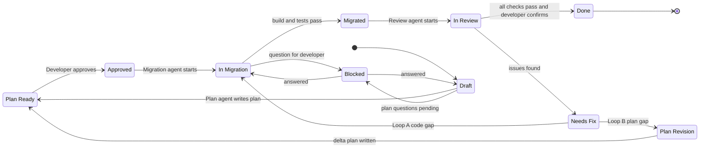
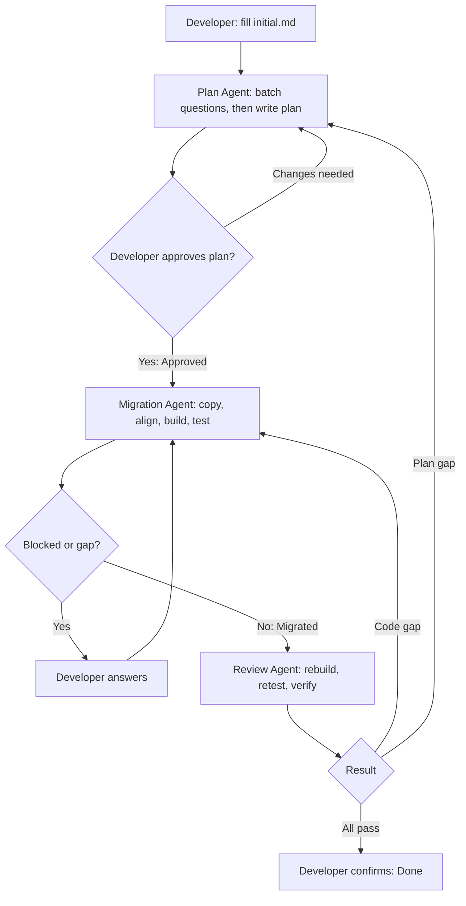
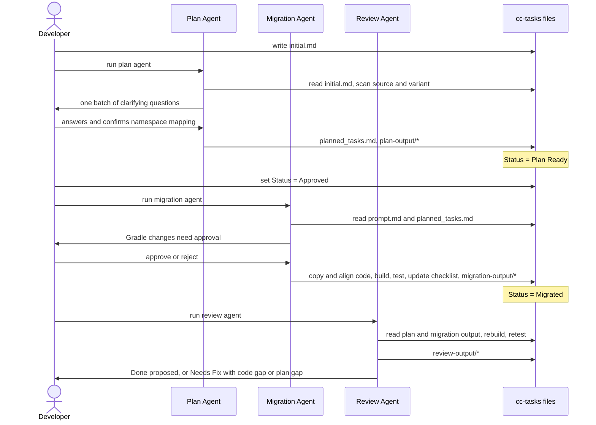

# Android Feature Migration Agents (Plan, Migration, Review)

A three-agent workflow for GitHub Copilot in Android Studio. It moves **one feature at a time** from a **source project** into a **variant source set** of a destination app using **lift and shift**.

This README is the outline. Review it, fix anything that is wrong, then we turn each section into the final agent and rules files.

---

## 1. Golden rules

1. **Source is read-only.** Never write, modify, delete or format anything in the source project.
2. **The only writable area is the destination variant** (`src/<flavor>/java`, `src/<flavor>/res`, `src/<flavor>/AndroidManifest.xml`, variant test source sets).
3. **Destination `main` is never scanned, reused or edited.** The variant is self-contained. If a migrated file needs something (including `BaseActivity`, `BaseFragment`, base custom views, base WebView classes), copy it from the **source** into the variant.
4. **Lift and shift.** Copy code as is. Take only the members the feature needs, not whole files full of unrelated things. If the file already exists in the variant, add only the feature's members and never remove or change existing ones.
5. **Alignment changes only.** The only edits to copied code are package, `R`, binding, `BR` and `BuildConfig` references, class names in XML and manifest, and import cleanup. Anything else is a forced change and goes in its own section of the output.
6. **Ask, do not assume.** Gradle edits, forced renames, and anything copy-plus-alignment cannot fix are developer decisions.
7. **Unit tests move with their classes.** Never delete or disable a test to get a green build.
8. **Wiring into `main` is the developer's job.** The agents hand over an entry contract.
9. **Do not break other flows.** Only variant files change (plus approved Gradle edits). The build is the validator.

---

## 2. Folder layout

```
.github/
  copilot-instructions.md        # short, always-on rules (golden rules + pointer to _shared/rules.md)
  agents/
    plan.agent.md
    migration.agent.md
    review.agent.md
  prompts/
    new-task.prompt.md           # turns your 4 inputs into initial.md
    resume.prompt.md             # reads the status header, says which agent is next

cc-tasks/
  _shared/
    rules.md                     # single source of truth for all three agents (section 5)
  <task-name>/
    initial.md                   # the 4 inputs (developer writes)
    planned_tasks.md             # status header + checklist per iteration
    plan-output/
      summary.md
      findings.md                # decisions, namespace mapping, Q&A, iteration notes
      prompt.md                  # per-file migration contract
    migration-output/
      summary.md                 # goal accomplished + entry contract
      file-map.md                # source file -> destination file, status, reason
      gaps.md                    # open questions, forced changes, fixes made
    review-output/
      checklist.md
      findings.md
```

Use `planned_tasks.md` everywhere. Do not mix `tasks.md` and `planned tasks.md`.

---

## 3. Diagrams

### 3.1 Status lifecycle



`Blocked` always records `blocked_from: <status>` so the agent resumes in the right place.

### 3.2 End-to-end flow



### 3.3 Who talks to whom (one iteration)



---

## 4. Inputs: `initial.md`

Only inputs live here. Behavior rules do not belong in the task file.

**Core principle: a field you fill in is a starting point, not a limit. The agent begins there but still follows the discovery traversal to find the whole feature. Only "Must exclude" and "Out of scope" are hard limits.**

```markdown
# Task: <task-name>

Status: Draft
Destination branch: migration/<task-name>
Source reference: <branch / tag / commit>   (blank = current checkout)

## 1. Source project directory path
<path>   (blank = default)
Source modules involved: <app, :lib-x, ...>   (blank = agent finds them)

## 2. Destination project path and variant
<path> / variant: <flavor>   (blank = default)
Build commands: assemble<Flavor>Debug, test<Flavor>DebugUnitTest   (blank = defaults)

## 3. Feature or functionality
<what the feature is, screens involved>
Entry point (if known): <class>
Launched in source via: <Intent / Fragment attach / route>   (optional)

## 4. Specific things
<quirks, special notes>
Must include: <classes, layouts, resources the agent might miss>
Must exclude: <anything that must not move>
Locales: all   (or list)
Gradle pre-approval: no   (or: flavor-scoped dependency additions at source versions)

## Out of scope
<other features living in the same files>

## References (optional)
<ticket, design, notes>
```

Fill the two default paths once in `copilot-instructions.md` so the agents can resolve blanks.

### How each field is used

| Field you fill in | How the agent treats it |
|---|---|
| **Entry point** | Seed for the traversal. The agent starts here but also follows the feature wherever it leads (other screens, deep links, other launch paths the feature uses) |
| **Launched in source via** | Documented first in the entry contract. Other launch paths the agent finds are listed alongside it |
| **Source modules involved** | Starting set to search. The agent follows references into other modules when the feature needs them and notes which ones |
| **Must include** | Always brought, in addition to whatever discovery finds |
| **Must exclude / Out of scope** | **Hard limit.** Never brought, even if the traversal reaches them. The agent notes what it skipped and why |
| **Locales** | A preference that is followed as given (all by default) |
| **Gradle pre-approval, Build commands, Source reference** | Settings, followed as given. Pre-approval covers only what is listed |

Blank fields: the agent resolves them from defaults or discovery. Everything resolved or discovered beyond your hints is written into `plan-output/findings.md`, so you can review it at plan approval.

## 5. Shared rules (`cc-tasks/_shared/rules.md`)

### 5.1 Access boundaries

| Area | Access |
|---|---|
| Source project (all of it) | Read-only. The only place code and resources are taken from |
| Destination variant source sets | Read and write |
| Destination `main` | Never scanned, reused or edited |
| `app/build.gradle` and other Gradle files | Only with developer approval, flavor-scoped where possible |

### 5.2 Discovery procedure (finding the "nested things")

The plan agent builds the file list with this traversal, not by guessing.

1. **Start at the entry point** in the source (Activity, Fragment, composable, route).
2. **Walk outward**, adding each reference to a **visited list**:
   - ViewModel, repository, use case, manager classes
   - data sources, API interfaces, models, enums, constants
   - adapters, view holders, listeners, callbacks, items, content objects
   - custom views, base classes the feature extends
   - Dagger pieces the feature uses (section 5.6)
   - analytics events and trackers
   - layouts and everything the layouts reference (drawables, colors, dimens, strings, styles, fonts, anim)
   - manifest declarations and navigation entries
   - unit tests for every class on the list
3. **Take only the needed members** from shared or multi-feature files (methods, constants, properties, nested classes).
4. **Stop when** there are no unvisited references left. Skip anything in the task's "Out of scope" list.
5. **Record the visited list** in `plan-output/findings.md` so the review agent can verify completeness.

### 5.3 Checklist of what a feature can include

- **Code:** Activities, Fragments, custom views, WebView and base classes, ViewModels, repositories, managers, models, nested classes, generics, adapters, view holders, listeners, analytics, utils, constants, Kotlin and Java files
- **UI:** Compose and XML layouts, menus, navigation graphs, data binding variables and imports
- **Resources:** colors, dimens, strings (default **and** every `values-xx`), styles, themes, fonts, drawables (all densities, night variants), images, anim, raw, xml, values
- **Manifest:** activities, services, receivers, providers, permissions, intent filters, meta-data
- **Dagger:** components, subcomponents, modules, provides and binds, scopes, qualifiers, inject targets
- **Tests:** unit tests, test resources, fakes and test utilities
- **Gradle (approval-gated):** dependencies, plugins, `buildFeatures`, `BuildConfig` fields, Proguard/R8 rules
- **Other:** feature flags and remote config keys, network layer pieces, database entities and DAOs (always ask before moving these)

### 5.4 Merge rules (file already exists in the variant)

| Situation | Action |
|---|---|
| File does not exist | Create it (and the package) with only the needed members |
| File exists | Add only the feature's methods, constants, properties, params. Never edit or remove existing members |
| Existing override in a variant base class | Keep it. Add only what the feature needs |
| Feature needs behavior that conflicts with an existing variant member | Stop and ask |
| Same resource name already in the variant | Existing file: add only the missing entries. If the same name has a different value, stop and ask |
| Same layout name already in the variant with different content | Stop and ask (view IDs and binding fields would change) |

### 5.5 Namespace and import alignment

The destination's `R`, binding, `BR` and `BuildConfig` come from the `namespace` in the destination `app/build.gradle`, **not** from the variant's folder or package. The source may differ, and may use several `R` packages (app and library modules).

1. Read the source namespace(s) and the destination `namespace`. Never guess.
2. Put a mapping table in `plan-output/findings.md` and get the developer's confirmation at plan approval:

| Item | Source package | Destination package |
|---|---|---|
| `R` | `<source.ns>.R` (and library `R`s) | `<dest.ns>.R` |
| Binding classes | `<source.ns>.databinding.*` | `<dest.ns>.databinding.*` |
| `BR` | `<source.ns>.BR` | `<dest.ns>.BR` |
| `BuildConfig` | `<source.ns>.BuildConfig` | `<dest.ns>.BuildConfig` |
| Feature classes | `<source.pkg>` | `<variant.pkg>` (keep names and structure as is unless forced) |

3. Apply the mapping to **Kotlin, Java, tests, layout XML, manifest and nav graphs**:
   - imports, including `import static` and wildcards (replace wildcards with explicit imports)
   - `<import type>` and `<variable type>` in data binding layouts
   - custom view tags and `android:name` for fragments and activities
   - manifest class names
   - inline fully qualified references (`com.source.R.id.x`) and reflection strings (flag, do not silently edit)
4. A file whose package equals the destination `namespace` needs no `R` import. Compare each file's new package before adding or removing imports.
5. If the destination uses non-transitive R classes, library resources need the owning module's `R`. Missing ones are copied into the variant `res`.
6. Optimize imports and remove wrong ones at the end.

### 5.6 Dagger

Dagger is **not a special case**. It follows the same lift-and-shift rules.

- Find the feature's Dagger pieces in the source (components, subcomponents, modules, provides, binds, scopes, qualifiers, inject classes, factories) and copy them as is.
- Take only the members the feature needs. If the file exists in the variant, add only those members.
- Align package, `R`, binding and `BuildConfig` imports only.
- Build. If Dagger reports a missing binding, copy that provider from the source and log it.
- Read the **first** Dagger error only. Later ones are usually cascades.
- If something cannot be fixed by copying or aligning (for example a duplicate binding), log it in `gaps.md` and ask.
- Missing `dagger`, `kapt` or `ksp` setup is a Gradle change and needs approval.

### 5.7 Gradle policy

- Compare the source and destination `app/build.gradle`: dependencies, plugins, `buildFeatures` (view binding, data binding, compose), `BuildConfig` fields, `kapt`/`ksp`, Proguard.
- **Always ask before editing.** Show exactly what will be added and why.
- Prefer flavor-scoped configurations (for example `<flavor>Implementation`, `test<Flavor>Implementation`).
- Use the version the source uses. If the destination already has the library at a different version, **do not bump**. Stop and ask.

### 5.8 Build and test gates

| Who | When | What |
|---|---|---|
| Migration agent | Before setting `Migrated` | `assemble<Flavor>Debug` and `test<Flavor>DebugUnitTest`. Fix mechanical errors, log them. Anything else goes to `gaps.md` |
| Review agent | Independently | Rebuild, rerun tests, run lint if available |

- **Mechanical errors (agent fixes and logs):** wrong namespace, missing import, unresolved `R` or binding, missing resource or class that exists in the source.
- **Everything else goes to the developer:** duplicate classes or bindings, behavior differences, failing tests caused by real differences, anything needing `main` changes.
- If the IDE plugin cannot run Gradle, the agent writes the exact commands to the checklist, you run them, and you paste the output back. The loop continues from there.

### 5.9 Must-ask list

1. Any Gradle or dependency change
2. Any forced rename (class, file, resource) beyond alignment
3. Duplicate class or duplicate binding errors
4. Same layout or resource name in the variant with different content
5. Database entities, DAOs, migrations
6. Anything that would require changing `main`
7. Version conflicts
8. Any assumption about behavior the agent cannot confirm from code

Ask all clarifying questions **in one batch**, not one at a time.

### 5.10 Entry contract (written by the migration agent, verified by review)

In `migration-output/summary.md`:

- Entry class, fully qualified name in the variant
- How it is launched: Intent action or component, required extras, Fragment arguments, `newInstance` signature
- Manifest entries added in the variant
- What the feature expects from the host: container view ID, theme, init call, callbacks to implement, Application-level requirements
- Tip: a string-based Intent contract is the safest way to wire from `main` when other flavors do not contain the class. A direct class reference needs a matching stub in the other flavors.

### 5.11 Forced changes section

Every output ends with a **Forced changes** section for anything beyond plain alignment: renames, signature changes, added parameters, stubbed members. Each entry has file, change, and reason.

### 5.12 Iteration rules

1. Never rewrite history. Add `Iteration N` sections to `planned_tasks.md`.
2. Completed items stay checked unless review proves them wrong (then uncheck with a note).
3. **Loop A (code gap):** no new approval. Migration redoes only failed items.
4. **Loop B (plan gap):** plan agent revises, developer re-approves, migration does only new or changed items.
5. **Scoped questions** on revision: only about the new gap. Re-ask an old decision only if the gap touches it.
6. **Full re-plan** if the traversal boundary was wrong or the same plan gap appears twice.
7. Same issue after two iterations: set `Blocked` and ask.
8. Review proposes `Done`. The developer sets it.

### 5.13 Hints are starting points

1. Details in `initial.md` (entry point, launch path, modules, must include) seed the traversal. They never limit it.
2. The agent still discovers the full feature with the traversal in 5.2, including parts you did not mention.
3. Anything found **beyond your hints** goes into a "Discovered beyond hints" section of `plan-output/findings.md` (what, where, why the feature needs it). You review it at plan approval and can strike items.
4. **Hard limits:** "Must exclude" and "Out of scope". The agent never brings those, even when the traversal reaches them, and logs what it skipped.
5. The review agent checks that every "Must include" item is present, nothing excluded was migrated, and everything discovered beyond hints was listed in the plan.

---

## 6. Agent outlines

### 6.1 Plan agent (`plan.agent.md`)

| | |
|---|---|
| **Reads** | `initial.md`, `_shared/rules.md`, source project, destination variant, both `app/build.gradle` files |
| **Writes** | `planned_tasks.md`, `plan-output/summary.md`, `findings.md`, `prompt.md` |
| **Never** | Writes code or touches source, `main` or variant files |
| **Exit status** | `Plan Ready` (or `Draft` with questions pending) |

Steps:
1. Resolve defaults for blank inputs. Use filled-in fields as starting points (5.13), and honor "Must exclude" and "Out of scope" as hard limits.
2. Read both namespaces and flavor setup. Build the mapping table.
3. Run the discovery traversal (5.2). Save the visited list.
4. Check which files already exist in the **variant** (merge vs create).
5. Find unit tests for every class.
6. Compare Gradle (5.7) and list required changes as approval items.
7. Raise **one batch** of questions: gaps, mapping confirmation, Gradle items, database items, anything on the must-ask list.
8. After answers, write the plan:
   - `planned_tasks.md`: status header plus phased checklist
   - `prompt.md`: the per-file contract (below)
   - `findings.md`: decisions, Q&A, mapping table, visited list
   - `summary.md`: short overview
9. Set status `Plan Ready` and ask for approval.

Suggested phases in `planned_tasks.md`:
1. Gradle approvals (if any)
2. Base and shared classes (variant copies)
3. Feature code (UI, ViewModel, data, adapters, managers, analytics)
4. Dagger pieces
5. Resources (layouts, strings incl. locales, colors, dimens, styles, fonts, drawables, anim)
6. Manifest and navigation
7. Namespace and import alignment pass
8. Unit tests
9. Build and test
10. Entry contract and summary

`prompt.md` per-file table:

| # | Source path | Destination path (variant) | Action (copy / merge / create) | Members to bring | Alignment needed | Notes |
|---|---|---|---|---|---|---|

On revision (Loop B), append `Iteration N` and list only new or changed rows.

### 6.2 Migration agent (`migration.agent.md`)

| | |
|---|---|
| **Reads** | `planned_tasks.md`, `plan-output/prompt.md`, `findings.md`, source, variant |
| **Writes** | Variant files only, plus `migration-output/*` and checklist updates |
| **Never** | Writes to source or `main`, edits Gradle without approval, deletes or disables tests, changes logic beyond alignment |
| **Entry condition** | Status is `Approved` (first run, or a Loop B delta after re-approval), or `Needs Fix` for a Loop A code gap |
| **Exit status** | `Migrated` (or `Blocked`) |

Steps:
1. Confirm status is `Approved`. Set `In Migration`.
2. Process the checklist phase by phase. After each item, tick it in `planned_tasks.md`.
3. For each file: copy or merge per `prompt.md`, apply the namespace mapping, optimize imports.
4. Gradle items: ask for approval first, then edit.
5. After code and resources, grep the migrated files for the **source namespace as a literal string** (all `.kt`, `.java`, `.xml`, manifest).
6. Move unit tests and align them.
7. Build and test (5.8). Triage errors: mechanical, fix and log. Semantic, log in `gaps.md` and ask.
8. Write `file-map.md`, `summary.md` (goal accomplished, entry contract, forced changes) and `gaps.md`.
9. Set `Migrated` and hand over to review.

On re-entry, work only on new or failed items, using `file-map.md` to see what is done.

`file-map.md` columns:

| Source path | Destination path | Status (copied / merged / created / skipped) | Members brought | Reason / notes |
|---|---|---|---|---|

### 6.3 Review agent (`review.agent.md`)

| | |
|---|---|
| **Reads** | Everything: plan, migration output, variant code, source (for comparison), Gradle files |
| **Writes** | `review-output/checklist.md`, `findings.md`, status updates in `planned_tasks.md` |
| **Never** | Fixes code itself (it reports and routes) |
| **Entry condition** | Status is `Migrated` |
| **Exit status** | `Done` (proposed), `Needs Fix`, or `Blocked` |

Checks:
1. **Plan check:** every file, resource and member from `prompt.md` is accounted for in `file-map.md`. The visited list is complete and nothing out of scope was pulled in.
2. **Completeness:** compare source feature files against the variant (code, resources, all locales, densities, night variants, manifest, tests).
3. **Namespace:** zero source-namespace references remain in Kotlin, Java, XML, manifest, tests.
4. **Imports:** every import resolves to the variant package, the destination `R` and binding packages, or an approved library. None silently resolve to a same-named class in `main` (for example `BaseActivity`).
5. **Merges:** existing variant members are unchanged. Only feature members were added.
6. **Boundary:** nothing changed outside the variant except approved Gradle edits (use `git diff` against the baseline if available, otherwise `file-map.md`).
7. **Gradle:** every edit was approved and no version was bumped.
8. **Build and tests:** rebuild `assemble<Flavor>Debug`, run `test<Flavor>DebugUnitTest`, run lint if available. Record results.
9. **Entry contract:** verify each item against the actual code and manifest.
10. **Forced changes:** each is listed with a reason.
11. **planned_tasks.md:** every checkbox ticked is true. Uncheck wrong ones with a note.
12. **Hints and limits:** every "Must include" item is present, nothing from "Must exclude" or "Out of scope" was migrated, and everything found beyond hints was listed in the plan (5.13).

Every issue is tagged **code gap** (plan was right, execution missed it) or **plan gap** (plan missed it), with the iteration number. The developer can override the tag.

`review-output/checklist.md` template:

```markdown
# Review checklist: <task-name> (Iteration N)

- [ ] Plan items all mapped in file-map.md
- [ ] Feature files complete vs source (code, res, locales, densities, night, manifest)
- [ ] No source namespace left (kt, java, xml, manifest, tests)
- [ ] Imports resolve to variant / destination namespaces (none to main classes)
- [ ] Existing variant members unchanged
- [ ] No changes outside variant (except approved Gradle)
- [ ] Gradle edits approved, no version bumps
- [ ] assemble<Flavor>Debug: PASS / FAIL
- [ ] test<Flavor>DebugUnitTest: PASS / FAIL (n run, n failed)
- [ ] Lint: PASS / FAIL / not run
- [ ] Entry contract matches code
- [ ] Forced changes documented
- [ ] planned_tasks.md matches reality

## Issues
| # | Description | File | Type (code gap / plan gap) | Iteration | Status |
|---|---|---|---|---|---|

## Verdict
Done proposed / Needs Fix / Blocked
```

---

## 7. Status header (top of `planned_tasks.md`)

```markdown
Status: Plan Ready
Iteration: 1
Blocked from: -
Last updated by: plan agent
Open issues: 0

## Iteration 1
### Phase 1: Gradle approvals
- [ ] ...
### Phase 2: Base and shared classes
- [ ] ...
```

| Status | Set by | Meaning |
|---|---|---|
| Draft | Developer | `initial.md` filled, plan not done |
| Plan Ready | Plan agent | Plan written, awaiting approval |
| Approved | Developer | Migration may start |
| In Migration | Migration agent | Code movement underway |
| Blocked | Any agent | Waiting on a developer answer (records `blocked_from`) |
| Migrated | Migration agent | All tasks done, build and tests pass |
| In Review | Review agent | Verification underway |
| Needs Fix | Review agent | Issues found, each tagged code gap or plan gap |
| Plan Revision | Plan agent | Plan updated because of a finding |
| Done | Developer | Review passed and confirmed |

---

## 8. How to use it: step-by-step

The prompts below are examples. Adjust the agent selection to however your Copilot plugin exposes agents or prompt files.

### Step 0: One-time setup

1. Create the files from section 2.
2. In `copilot-instructions.md`, set the default source path, default destination path and variant, and point to `cc-tasks/_shared/rules.md`.
3. In the destination repo, **create a branch and commit a baseline** before any migration (`migration/<task-name>`). The source is untouched and writes only go into the variant, so rollback is simply reverting that branch.
4. Confirm in your plugin: are custom agents and prompt files supported, and can the agent run terminal commands (Gradle)? If custom agents are not supported, use the same three roles as prompt files.

### Step 1: Create the task

Copy the template from section 4 into `cc-tasks/<task-name>/initial.md`. Example:

```markdown
# Task: order-tracking

Status: Draft

## 1. Source project directory path
(blank, use default)

## 2. Destination project path and variant
(blank, use default)

## 3. Feature or functionality
Order tracking screen: OrderTrackingActivity, map card, status timeline, push-status updates.

## 4. Specific things
Includes the WebView-based help page used from this screen. Do not migrate the order history feature that shares OrderRepository.

## Out of scope
Order history, reorder flow.
```

### Step 2: Run the Plan agent

Prompt:

```text
@plan Run the plan for cc-tasks/order-tracking. Read initial.md and _shared/rules.md.
Ask me all clarifying questions in one batch before writing the plan.
```

Expect: a single batch of questions (namespace mapping to confirm, Gradle diffs, database items, entry point confirmation, any gaps).

### Step 3: Answer the questions

Answer in the chat, or write the answers into `plan-output/findings.md` under "Q&A". Example reply:

```text
1. Mapping confirmed: source com.src.app -> destination com.dst.app.
2. Gradle: approved to add flavor-scoped dependency X at source version.
3. Skip the DB entity OrderCache, handled elsewhere.
4. Entry point is OrderTrackingActivity, launched by explicit Intent.
```

### Step 4: Review and approve the plan

1. Open `planned_tasks.md` and `plan-output/prompt.md`.
2. Check the per-file table, the mapping table, the visited list and the Gradle items.
3. If something is wrong, tell the plan agent what to change. It updates the plan and stays in `Plan Ready`.
4. When happy, set `Status: Approved` in `planned_tasks.md`.

### Changing the plan (before or after review)

The files are the contract. The migration agent reads `planned_tasks.md` and `plan-output/prompt.md`, never the chat.

| How | Use it for | Note |
|---|---|---|
| **Prompt the plan agent** (default) | Anything beyond one line: adding or removing files, merge decisions, mapping changes | It updates `planned_tasks.md`, `prompt.md`, `findings.md` and `summary.md` together and logs the change |
| **Edit the files yourself** | Small local fixes: strike a line, correct a path, untick a task | Then ask the plan agent to re-read all plan files and sync them, so nothing disagrees |

Example prompt:

```text
@plan Update the plan for cc-tasks/order-tracking:
- remove OrderCache from the migration list
- also include the help WebView layouts
Keep status Plan Ready and log this under "Plan edits" in findings.md.
```

Rules:
1. Status stays `Plan Ready` until you set `Approved`.
2. If you edit after `Approved` but before migration starts, set the status back to `Plan Ready` first.
3. If migration is already running, stop it (status `Blocked`) and make the change as a plan revision.
4. Every plan change is logged under "Plan edits" in `findings.md` with the reason.

### Step 5: Run the Migration agent

```text
@migration Migrate cc-tasks/order-tracking. The plan is Approved.
Follow plan-output/prompt.md, tick planned_tasks.md as you go, ask before any Gradle change.
```

During the run:
- It asks before editing Gradle. Reply `approve` or `reject` with a note.
- It builds and runs tests before setting `Migrated`.
- If it hits something it cannot fix mechanically, it sets `Blocked` and asks. Answer, and it resumes from `blocked_from`.

### Step 6: Run the Review agent

```text
@review Review cc-tasks/order-tracking. Rebuild the <flavor> variant, run unit tests,
verify planned_tasks.md and the entry contract, and write review-output/.
```

If the agent cannot run Gradle, run the commands it lists yourself, paste the output back, and tell it to continue.

### Step 7: Handle the outcome

- **Done proposed:** read `review-output/checklist.md`, then set `Status: Done` yourself.
- **Needs Fix, code gap:** run `@migration` again. It fixes only the failed items.
- **Needs Fix, plan gap:** run `@plan` again with the finding. It asks scoped questions, you re-approve, then run `@migration` for the delta.

### Step 8: Wire it in (yours)

Use the entry contract in `migration-output/summary.md` to call the feature from `main`, based on your `BuildConfig` condition. Build every flavor that compiles `main`, to confirm other flavors still build.

---

## 9. Scenario cookbook

| Scenario | What to do |
|---|---|
| **Blank inputs in `initial.md`** | The agents use the defaults from `copilot-instructions.md` and state which defaults they used |
| **Destination file already exists in the variant** | The plan marks it `merge`. The migration agent adds only the feature's members and never edits existing ones |
| **Feature uses a base class (`BaseActivity` etc.)** | The variant gets its own copy of the needed members from the **source** base class. Never reuse `main`'s base class |
| **Dagger module has many unrelated providers** | Only the reached providers are brought. If the build reports a missing binding, the agent copies it from source and logs it |
| **Missing library in destination** | The plan lists it under Gradle approvals. You approve, the agent adds it flavor-scoped at the source version |
| **Library exists at a different version** | The agent stops and asks. It never bumps the version |
| **Build fails with a wrong import or `R` error** | Mechanical. The agent fixes it, logs it under forced changes, and rebuilds |
| **Build fails with duplicate class or duplicate binding** | Semantic. The agent logs it in `gaps.md` and asks. Typical choices: rename the variant class, drop the copy, or you resolve it in `main` |
| **Source has no unit tests** | The plan states "no tests found". Review confirms it. No tests are invented |
| **Unit tests fail after migration** | Reported, never disabled. If the failure is a real behavior difference, it goes to you |
| **Gradle cannot run inside the IDE plugin** | The agent writes the commands. You run them and paste the output back |
| **Review finds a missing manifest entry the plan never listed** | Plan gap. Loop B, scoped questions, you re-approve |
| **Review finds a resource the plan listed but migration skipped** | Code gap. Loop A, no re-approval |
| **Same issue returns after two iterations** | Status becomes `Blocked`. The agent asks you and may run a full re-plan |
| **You come back after a break** | Run `/resume` (the resume prompt). It reads the status header and tells you which agent to run |
| **You want to abort** | Revert the destination branch to the baseline commit. The source was never changed |
| **Several features to migrate** | One task folder per feature. Run them one at a time so merges into shared variant files stay predictable |
| **Feature needs the database** | Always on the must-ask list. Nothing is moved until you decide |

---

## 10. Troubleshooting

| Symptom | Likely cause | Fix |
|---|---|---|
| Unresolved `R.string.x` | Resource not copied, or source `R` import left behind | Copy the resource from the source into the variant `res`. Re-run alignment |
| Binding class not found | Layout missing in the variant, or view/data binding not enabled | Copy the layout. If the flag is missing, it is a Gradle approval item |
| `BuildConfig` field not found | Field exists only in source flavor config | Gradle approval item: add the field to the destination flavor block |
| Data binding fails on a type | `<import type>` still points at a source package | Update the layout's type references to the variant package |
| App crashes on inflating a layout | Style or theme attribute missing in the variant | Copy the style and theme pieces from source (runtime issue, only visible on a device) |
| Same-named class compiles but behaves differently | Import silently resolves to a `main` class | Review import check. Copy the source version into the variant and fix the import |
| Dagger "cannot be provided" | Over-trimmed provider | Copy that provider from source and rebuild. Read only the first error |
| Agent keeps asking the same question | Answer not recorded | Put the answer in `plan-output/findings.md` under Q&A |

---

## 11. Before first use

1. **Verify plugin capabilities:** custom agents (`.agent.md`), prompt files, and terminal execution in the Android Studio Copilot plugin. If any are missing, use prompt files and run Gradle manually.
2. **Fill in the defaults:** source path, destination path, flavor name.
3. **Confirm placeholders:** `<flavor>`, `<Flavor>`, `<source.ns>`, `<dest.ns>`, `<variant.pkg>` are resolved by the agents from the Gradle files, never typed from memory.
4. **Run a pilot** on one small, real feature that includes Dagger, a layout with binding, strings in more than one locale, and a unit test. The pilot shows which of the risks above actually hit your projects. Tune `_shared/rules.md` from what it shows.

---

## 12. Agent file skeleton (starting point)

```markdown
---
name: plan
description: Plans a lift-and-shift Android feature migration from a source project into a destination variant. Reads code, writes only .md files under cc-tasks.
---

You are the Plan agent. Follow cc-tasks/_shared/rules.md without exceptions.

Never write code. Never modify the source project, destination main or variant files.
Ask all clarifying questions in one batch, then write the plan, then set Status: Plan Ready.

Inputs: cc-tasks/<task>/initial.md
Outputs: planned_tasks.md, plan-output/summary.md, findings.md, prompt.md
```

`migration.agent.md` and `review.agent.md` follow the same shape, with the "Reads / Writes / Never / Entry condition / Exit status" tables from section 6 as the body. Check the exact frontmatter fields your plugin version supports before relying on them.
