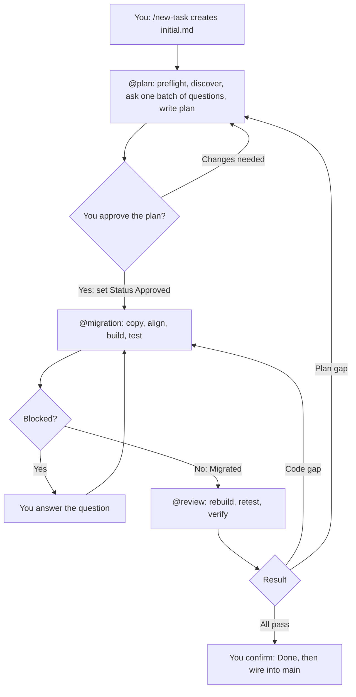
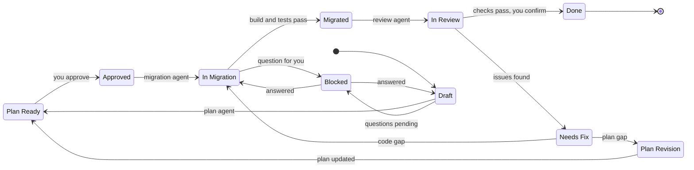

# Android Feature Migration Agents

Three GitHub Copilot agents (Plan, Migration, Review) that move **one feature at a time** from a **source project** into a **variant** of your destination app, using **lift and shift**. You approve at the key gates. Progress is tracked in checklists.

This README explains setup and use. The detailed rules live in `cc-tasks/_shared/rules.md` and apply to all three agents.

---

## 1. What is in this package and where it goes

```
migration-agents/
  README.md                          <- this guide (keep it anywhere, not needed in the repo)
  .github/
    copilot-instructions.md          <- short always-on rules + your default paths
    agents/
      plan.agent.md
      migration.agent.md
      review.agent.md
    prompts/
      new-task.prompt.md             <- /new-task
      resume.prompt.md               <- /resume
  cc-tasks/
    _shared/
      rules.md                       <- the single source of truth for all agents
      templates.md                   <- formats for every output file
```

Copy **`.github/`** and **`cc-tasks/`** into the **destination repo root** (the folder with `app/`, `settings.gradle` and `.git`, which is the project open in Android Studio). If you already have a `.github/copilot-instructions.md`, append ours to it instead of overwriting.

### What your workspace looks like after setup

```
/path/to/source-pinned/                  <- OUTSIDE the destination. Read-only. Pinned checkout
  app/ ...

/path/to/destination-repo/               <- open this in Android Studio
  .github/                               <- copied from this package
  cc-tasks/
    _shared/                             <- copied from this package
    <task-name>/                         <- created per feature
      initial.md                         <- you, via /new-task
      planned_tasks.md                   <- plan agent; migration agent ticks it
      plan-output/        summary.md  findings.md  prompt.md
      migration-output/   summary.md  file-map.md  gaps.md
      review-output/      checklist.md  findings.md
  app/
    build.gradle                         <- shared; edited only with your approval
    src/
      main/                              <- another product's code. NEVER touched
      <flavor>/                          <- your variant: the ONLY writable code area
        java/   res/   AndroidManifest.xml
      test<Flavor>/                      <- variant unit tests
```

| Agent | Writes | Never writes |
|---|---|---|
| `@plan` | `cc-tasks/<task-name>/` plan files | any code |
| `@migration` | `app/src/<flavor>/...`, approved Gradle edits, its own output files | the source project, `app/src/main` |
| `@review` | `review-output/` and `planned_tasks.md` corrections | any code |

---

## 2. How it works



Status lifecycle (written in the first lines of `planned_tasks.md`):



---

## 3. Rules in short

1. **Source is read-only.** Nothing there is ever written or changed.
2. **Only the variant is writable.** `app/src/main` is never scanned, reused or edited. The variant is self-contained: anything the feature needs (including base classes) is copied from the source.
3. **Lift and shift.** Copy as is, only the members the feature needs. If a variant file exists, add only the feature's members and never edit existing ones.
4. **Alignment edits only:** package, `R`, binding, `BR`, `BuildConfig`, class names in XML and manifest, imports. The destination namespace is read from `app/build.gradle`. Anything else is a "forced change" listed separately.
5. **Dagger is not special.** Same lift and shift. Missing pieces are copied from the source.
6. **Ask, never assume.** Gradle changes, forced renames, duplicate classes or bindings, database items, anything needing a change in `main`.
7. **Unit tests move with their classes.** A test is never deleted or disabled to get a green build.
8. **Your hints are starting points.** Only "Must exclude" and "Out of scope" are hard limits.
9. **Wiring into `main` is yours.** The agents give you an entry contract.
10. **You set `Approved` and `Done`.** Agents only propose.

Full detail: `cc-tasks/_shared/rules.md`.

---

## 4. One-time setup

1. **Copy the files** (section 1) into the destination repo root.
2. **Show hidden folders:** in Android Studio switch the Project tool window from Android view to **Project** view.
3. **Fill in the defaults** in `.github/copilot-instructions.md`: the three `<FILL_IN>` values (default source path, destination path, variant).
4. **Prepare the source.** Make a clean checkout of the source project at the tag or commit you want, in a folder outside the destination repo, and make it read-only:

   ```bash
   git -C /path/to/source-project worktree add /path/to/source-pinned <tag-or-commit>
   chmod -R a-w /path/to/source-pinned        # macOS / Linux (Windows: read-only in folder properties)
   ```

   Use `/path/to/source-pinned` as the source path in your tasks.
5. **Create the destination branch** from a clean working tree (`git status`):

   ```bash
   git checkout -b migration/<task-name>
   ```

   Its starting commit is the baseline the review agent compares against.
6. **Keep the tooling out of your PR.** Add to `.git/info/exclude` (local only, recommended):

   ```text
   .github/agents/
   .github/prompts/
   cc-tasks/
   ```

   (Or commit them on the migration branch only and remove before the PR.) The agents' boundary checks ignore `.github/` and `cc-tasks/`.
7. **Run the preflight tests** in Copilot chat:
   - *Read test:* "Open `/path/to/source-pinned/app/build.gradle` and show the first 20 lines." Must work. If it cannot read outside the project, put the source inside the workspace instead (a snapshot folder, or an attached content root).
   - *Terminal test:* "Run `ls` on `/path/to/source-pinned/app/src`." If there is no terminal, you run Gradle and copy images and fonts yourself, and the agents tell you exactly what to run.
   - *Agent test:* type `@plan` and `/new-task`. They must appear. If your plugin version does not support custom agents or prompt files, the same content can be used as plain prompt files.
8. **Check the flavor:** your variant name must exist in `productFlavors` in `app/build.gradle`.

---

## 5. Using it, step by step (per feature)

| Status | You do |
|---|---|
| (no task yet) | `/new-task` |
| Draft | `@plan cc-tasks/<task-name>` and answer its single batch of questions |
| Plan Ready | Review the plan files, then set `Status: Approved` yourself |
| Approved | `@migration cc-tasks/<task-name>` |
| Blocked | Answer the question the agent asked, then re-run the same agent |
| Migrated | `@review cc-tasks/<task-name>` |
| Needs Fix | Code gap: `@migration`. Plan gap: `@plan`. The review says which |
| Done proposed | Read `review-output/checklist.md`, then set `Status: Done` yourself |
| Not sure | `/resume` with the task name. It says the next command |

### The `initial.md` fields

Created by `/new-task` from your answers. Only the fields you know need to be filled in.

| Field | How the agent uses it |
|---|---|
| Source path, source reference | Where to read from, and which commit it should be at. Blank: default |
| Source modules involved | Starting set to search. The agent follows references into other modules if needed |
| Destination path, variant | Where to write. Blank: default |
| Entry point, launched via | Where discovery starts. The agent still finds the rest of the feature |
| Must include | Always brought, on top of discovery |
| Must exclude, Out of scope | **Hard limit.** Never brought |
| Locales | Followed as given (all by default) |
| Gradle pre-approval | Covers only what you list. Everything else is still asked |
| Build commands | Used as given. Default: `assemble<Flavor>Debug`, `test<Flavor>DebugUnitTest` |

Anything the agent discovers beyond your hints is listed under "Discovered beyond hints" in `plan-output/findings.md` so you can strike items at approval.

### Changing the plan

The files are the contract: the migration agent reads `planned_tasks.md` and `plan-output/prompt.md`, never the chat.

- **Bigger change:** prompt `@plan` ("remove X, also include Y, log under Plan edits"). It updates all plan files together.
- **Small fix:** edit the file yourself, then ask `@plan` to re-read and sync all plan files.
- If you edit after `Approved` but before migration starts, set the status back to `Plan Ready`. If migration is running, stop it first and handle the change as a plan revision.

### The two fix loops

- **Code gap** (the plan was right, execution missed it): `@migration` fixes only those items. No new approval.
- **Plan gap** (the plan missed it): `@plan` asks scoped questions about that gap only, you re-approve the small delta, then `@migration` does only the new items.
- The same issue still open after two iterations: the agent sets `Blocked` and asks you.

---

## 6. Worked example

Illustrative names. Use your own.

**Use case:** move "Pay My Vendor" from the standalone source project into the `cc` variant of the destination app.

| Value | Example |
|---|---|
| Source (pinned, read-only) | `/Users/dev/projects/source-pinned` at tag `release-9.4.0` |
| Destination repo | `/Users/dev/projects/destination-app` |
| Variant | `cc` (so `src/cc/...` and `src/testCc/...`) |
| Source namespaces | `com.xyz.src` (app), `com.xyz.src.core` (library `R`) |
| Destination namespace | `com.xyz.dst` (from `app/build.gradle`) |

**1. Create the task.** Type `/new-task` and answer one message:

```text
Task name: pay-my-vendor
Source: /Users/dev/projects/source-pinned (tag release-9.4.0)
Destination: default / variant: default
Feature: Pay My Vendor, entry PayVendorActivity, launched via explicit Intent
Must include: the help WebView and its layouts
Must exclude: payment history (shares PaymentRepository)
Locales: all
Gradle pre-approval: no
```

**2. Plan.** `@plan cc-tasks/pay-my-vendor`. After the preflight report it asks one batch:

```text
1. Namespace mapping: com.xyz.src.R and com.xyz.src.core.R -> com.xyz.dst.R. Confirm?
2. Gradle: source uses play-services-maps 18.2.0, destination does not.
   Add as ccImplementation at 18.2.0?
3. Database: PayVendorCache (Room entity) is reached by the feature. Include or exclude?
4. PaymentRepository is shared with payment history (excluded). Bring only the
   methods PayVendorViewModel uses. Confirm?
```

You reply: `1 Confirmed. 2 Yes, approved. 3 Exclude, handled elsewhere. 4 Confirmed.`
It writes `planned_tasks.md` and `plan-output/*`, status `Plan Ready`. Sample rows of `prompt.md`:

| # | Source path | Destination path (variant) | Action | Members | Alignment |
|---|---|---|---|---|---|
| 1 | `.../ui/PayVendorActivity.kt` | `app/src/cc/java/.../ui/PayVendorActivity.kt` | create | whole file | package, `R`, binding |
| 2 | `.../data/PaymentRepository.kt` | `app/src/cc/java/.../data/PaymentRepository.kt` | merge | `payProvider()`, `lookupProvider()` | package |
| 3 | `.../res/values/strings.xml` | `app/src/cc/res/values/strings.xml` | merge | 14 `pay_provider_*` strings | none |

**3. Approve.** Read the plan (check the mapping table and "Discovered beyond hints"), then edit the first lines of `planned_tasks.md` to `Status: Approved`.

**4. Migrate.** `@migration cc-tasks/pay-my-vendor`. You will see:
- the Gradle change shown and a wait for your `approve`
- a build error for a missing string that lived in a source library: copied into the variant `res` and logged as a mechanical fix
- a duplicate `PaymentApi` binding: not mechanical, so status `Blocked` with the options in `gaps.md`. You reply "keep the existing variant binding, skip the copied one" and it continues
- build and tests pass, outputs written, status `Migrated`

Entry contract in `migration-output/summary.md`:

```text
Entry class: com.xyz.dst.paymyvendor.ui.PayVendorActivity
Launch: explicit Intent to that class, optional extra "provider_id" (String)
Manifest: activity added in src/cc/AndroidManifest.xml
Host must provide: nothing else
```

**5. Review.** `@review cc-tasks/pay-my-vendor`. Result: `Needs Fix`.

| # | Issue | Type |
|---|---|---|
| 1 | `values-es/strings.xml` entries missing (planned, but skipped) | Code gap |
| 2 | Source manifest declares `ACCESS_FINE_LOCATION`, plan never listed it | Plan gap |

**6. Loops.** Issue 1: run `@migration`, it fixes only that. Issue 2: run `@plan`, answer its one scoped question, set `Approved` again, run `@migration` for the delta. Run `@review` again: all pass, `Done` proposed.

**7. Finish.** Set `Status: Done`. Wire the feature from `main` yourself using the entry contract (for example launch it when your `BuildConfig` condition is true; give other flavors a stub or use a string-based Intent so they still build). Build every flavor that compiles `main`. Open your PR from `migration/pay-my-vendor`.

---

## 7. Common situations

| Situation | What happens |
|---|---|
| File already exists in the variant | Plan marks it `merge`. Only the feature's members are added, existing ones untouched |
| Feature extends `BaseActivity` or similar | The variant gets its own copy of the needed members from the **source** base class. `main`'s is never used |
| Dagger module has many unrelated providers | Only reached providers move. A missing binding is copied from the source and logged |
| Library missing in destination | Listed as a Gradle approval. Added flavor-scoped at the source version after your OK |
| Library exists at a different version | The agent stops and asks. It never bumps versions |
| Wrong import or `R` error | Mechanical. Fixed, logged, rebuilt |
| Duplicate class or duplicate binding | You decide. Logged in `gaps.md` with options |
| Source has no unit tests | Plan says so. No tests are invented |
| Unit tests fail | Reported, never disabled. A real behavior difference goes to you |
| No terminal in the plugin | Agents write the exact commands. You run them and paste the output back |
| Images and fonts | Copied with `cp`, or listed for you to copy if there is no terminal. Review checks they arrived |
| Feature touches the database | Always asked first |
| Several features | One task folder each. Run them one at a time |
| Come back after a break | `/resume` |
| Want to abort | Revert the destination branch to the baseline. The source was never changed |

### Troubleshooting

| Symptom | Likely cause | Fix |
|---|---|---|
| Unresolved `R.string.x` | Resource not copied, or source `R` left behind | Copy the resource from the source into the variant `res`, re-run alignment |
| Binding class not found | Layout missing in variant, or view/data binding not enabled | Copy the layout. A missing flag is a Gradle approval item |
| `BuildConfig` field not found | Field exists only in the source config | Gradle approval item: add it to the destination flavor block |
| Data binding fails on a type | `<import type>` still points to a source package | Update the layout's type references |
| Crash inflating a layout | Style or theme attribute missing in the variant | Copy the style and theme pieces from the source |
| Same-named class behaves differently | Import silently resolved to a `main` class | Review import check. Copy the source version into the variant, fix the import |
| Dagger "cannot be provided" | Piece trimmed too far | Copy that provider from the source, rebuild. Read only the first error |
| Agent repeats a question | Answer was not recorded | Put it in `plan-output/findings.md` under Q&A |

---

## 8. Limits and what to verify

- **I could not test this in your Android Studio.** Check that your Copilot plugin supports custom agents (`.agent.md`), prompt files and, ideally, terminal commands. The agent files use only `name` and `description` in their frontmatter. Add more fields if your plugin needs them.
- **The agents can only read the source if Copilot can open files outside the open project.** The read test in setup step 7 settles this.
- **Only a build proves some things:** generated binding and Dagger classes, resource merging, theme and style behavior at runtime. The agents build, but you should still run the feature on a device.
- **Pilot first.** Run one small real feature that has Dagger, a data binding layout, strings in more than one locale and a unit test. Whatever breaks, tune `cc-tasks/_shared/rules.md` first. One change there applies to all three agents.
